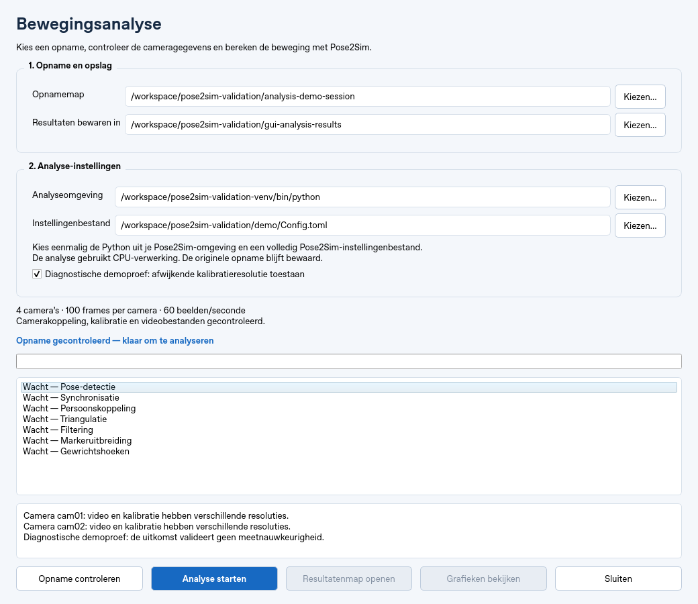
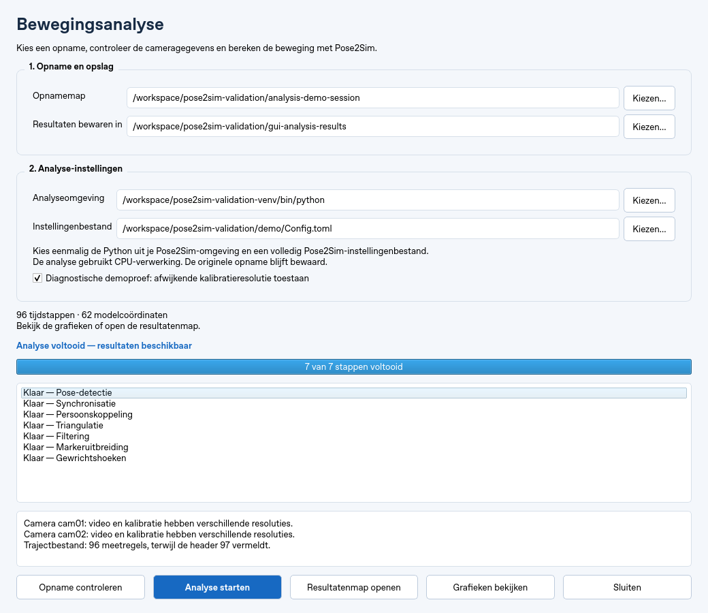
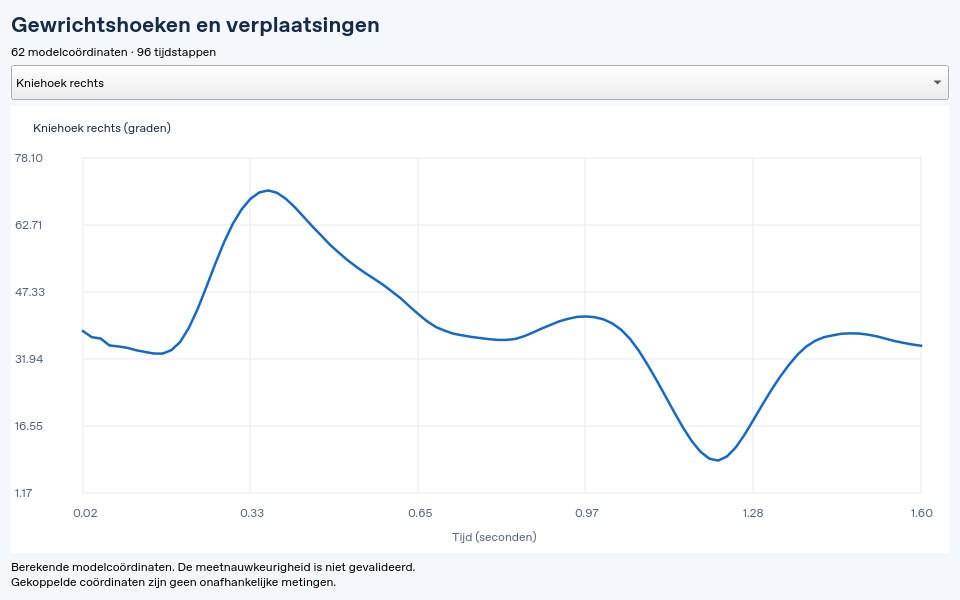

# Nederlandstalige analysebediening

Open **Analyse → Bewegingsanalyse…**, of gebruik **Bewegingsanalyse…** bij de
opnameknoppen. Stop eerst de live weergave en wacht tot een opname is afgerond.
Een zojuist bewaarde opname wordt bij het openen automatisch ingevuld.

## Van opname naar resultaat

1. Kies de opnamemap met `session.json` en de map waarin resultaten mogen komen.
   Resultaten moeten buiten de opname worden bewaard.
2. Kies eenmalig de Python uit de afzonderlijke Pose2Sim-omgeving en het volledige
   Pose2Sim-instellingenbestand. Deze twee keuzes worden lokaal onthouden.
3. Klik **Opname controleren**. Dit controleert camerakoppeling, kalibratie,
   frameverlies, videobestanden, instellingen en beschikbaarheid van Pose2Sim.
   Het venster blijft tijdens deze controle reageren.
4. Als de controle slaagt, wordt **Analyse starten** beschikbaar. Een wijziging
   aan de invoer of instellingen maakt een nieuwe controle noodzakelijk.
5. Volg de zeven stappen. De analyse gebruikt een nieuwe, unieke uitvoermap;
   eerdere resultaten worden niet overschreven. De invoer wordt bij het starten
   opnieuw gecontroleerd. Een fout wordt in het venster en het analyserapport
   vastgelegd.
6. Open na afloop **Resultatenmap openen** of **Grafieken bekijken**.

De grafiekviewer biedt alle coördinaten uit het hoekbestand aan. De geteste demo
heeft 62 coördinaten: hoeken, verplaatsingen en gekoppelde modelcoördinaten.
Bekende coördinaten hebben Nederlandse namen. Bekken-/rompverplaatsingen worden
in meters getoond; de hoekeenheid volgt de OpenSim-header. Gekoppelde
coördinaten zijn geen onafhankelijke metingen.

De instelling **Diagnostische demoproef** staat standaard uit. De officiële
demo heeft een bekende afwijking tussen video- en kalibratieresolutie; daarom
is deze uitzondering nodig om de functionele demo uit te voeren. Framegaten
blijven altijd geblokkeerd. Gebruik de uitzondering niet als bewijs dat een
echte opname geometrisch geschikt is.

Sluiten is tijdens de controle en analyse geblokkeerd, ook voor het hoofdvenster.
Deze versie heeft nog geen annuleerfunctie: wacht tot de uitvoering is afgerond
of een stap zijn tijdslimiet bereikt. Er wordt geen actieve encoder- of
OpenSim-stap afgebroken door het venster te sluiten.

## Interfacevoorbeelden

Dit zijn screenshots van de daadwerkelijk gebouwde Qt-vensters, met de
Pose2Sim-demo in de Linux-cloudomgeving. Ze tonen de bediening die je kunt
beoordelen zonder de app te installeren. Windows gebruikt mogelijk andere
lettertypen en vensterranden.

### Opname gecontroleerd

### Analyse voltooid

### Grafiekviewer

## Validatie en Windows

De cloudproef gebruikt de echte Qt-procesaanroep. De normale demo-invoer wordt
terecht geblokkeerd vanwege het resolutieverschil; de expliciete diagnostische
controle slaagt. Daarna doorloopt de GUI alle zeven analysestappen en worden
alle 62 grafiekselecties getest. Een Qt-timer blijft tijdens de analyse tikken,
waarmee is gecontroleerd dat de interface blijft reageren.

De bestaande kalibratie-/opnametests en nieuwe GUI-tests slagen samen: 50 tests.
Het menu en de analyseknop zijn ook in het bestaande hoofdvenster gecontroleerd.
De PyInstaller-specificatie bewaart een kleine Python-runtime voor de adapter;
de externe Pose2Sim-interpreter kan modules niet uit het archief van de exe
importeren. Pose2Sim en OpenSim blijven buiten de HuCalib-bundel. De runtime is
afzonderlijk op import en invoercontrole getest.

Dit vervangt geen Windows-test: exe/installer, bestandsdialogen, openen in
Verkenner, driverwerking en echte webcamopnames moeten daar nog worden getest.
Er is geen nieuwe Windows-release gepubliceerd.
