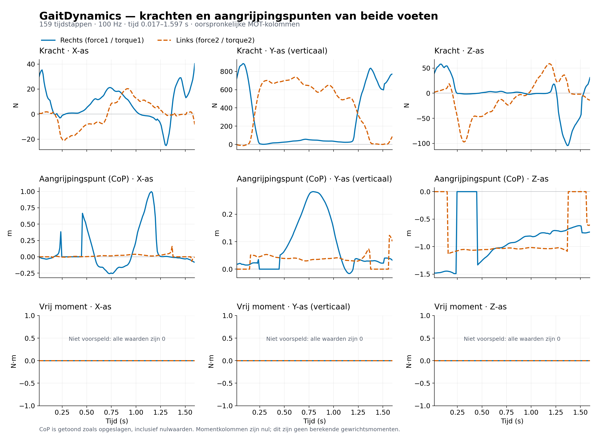

# GaitDynamics: voorbeeldresultaat uit Windows en WSL2

Deze grafiek toont de 18 gegevenskolommen van het aangeleverde
`ground_reaction_forces.mot` uit de Pose2Sim-voorbeeldproef:
159 tijdstappen bij 100 Hz, van 0,01667 tot 1,59667 seconden.
De oorspronkelijke waarden zijn zonder filtering of normalisatie getekend.

[Download de PDF](gaitdynamics-alle-kolommen-windows.pdf)

- Blauw: rechtervoet (`force1`); oranje: linkervoet (`force2`).
- Boven: krachtcomponenten in newton. De Y-as is verticaal in OpenSim.
- Midden: aangrijpingspunten (CoP) in meters, inclusief opgeslagen nulwaarden.
  Dit is geen grafiek van de voetbaan. De CoP is bij geringe contactkracht
  niet betrouwbaar te interpreteren.
- Onder: de zes momentkolommen. Ze bevatten uitsluitend nullen; GaitDynamics
  voorspelt deze vrije momenten niet. Dit zijn geen gewrichtsmomenten.

Dit resultaat laat zien dat de technische rekenketen op Windows via WSL2
kan afronden. Het valideert de nauwkeurigheid van de voorspelde krachten niet.
Het betreft een modelvoorspelling, geen krachtplaatmeting.
