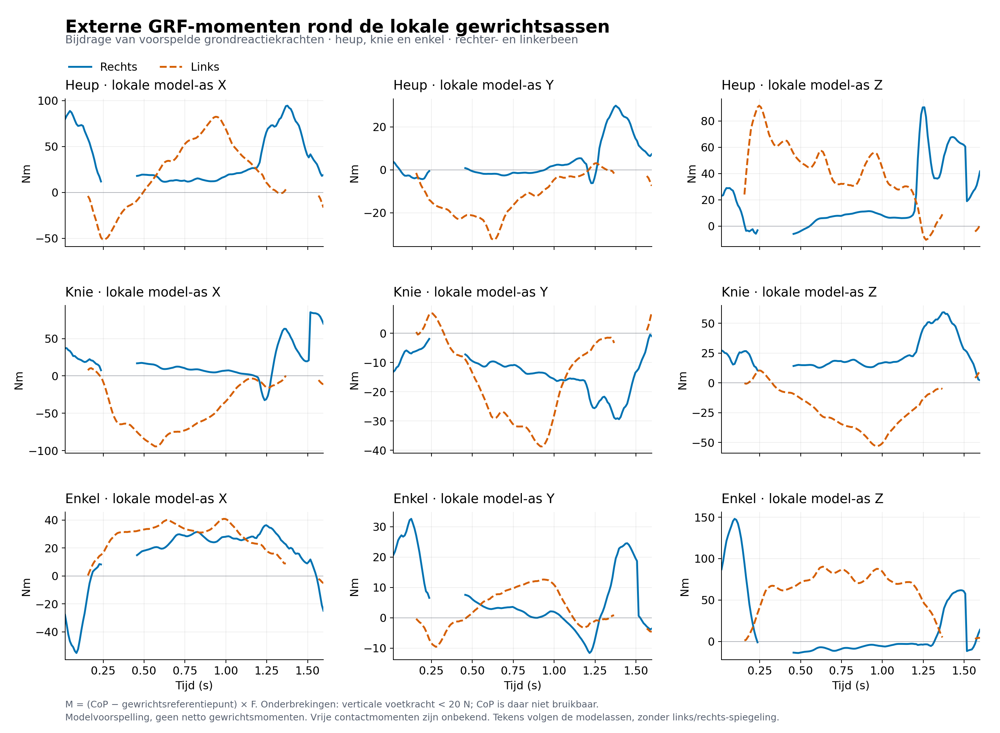
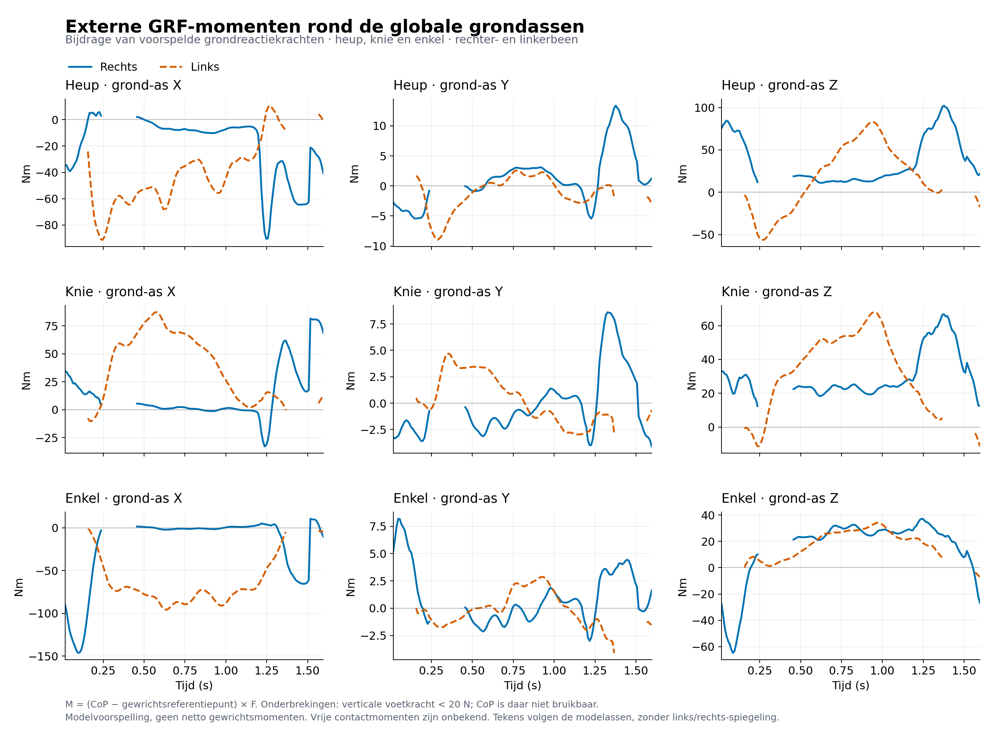

# Externe momenten door de grondreactiekracht

Deze afzonderlijke berekening gebruikt de aangeleverde Pose2Sim/GaitDynamics-
voorbeeldresultaten. Ze berekent de bijdrage van de rechter grondreactiekracht
rond rechter heup, knie en enkel, en die van de linker grondreactiekracht rond
de overeenkomstige linker gewrichten. Alle drie ascomponenten zijn in Nm.

**Correctie van de bewegingscontext:** de gebruiker identificeert deze proef als
een eenbenige evenwichtsoefening, geen loopbeweging. De GaitDynamics-krachten
zijn voor deze beweging niet gevalideerd. Deze grafieken zijn daarmee
uitsluitend een technische berekening op basis van die voorspellingen.
Zie de [vastgelegde gevolgen en vervolgroute](../inverse-dynamica/README.md#correctie-dit-is-geen-loopbeweging).

## Grafieken

**Lokale gewrichtsassen uit het OpenSim-model:**



[PDF lokale assen](grf-momenten-lokaal.pdf) · [CSV lokale assen](grf-momenten-lokaal.csv)

**Dezelfde momentvectoren uitgedrukt in de globale grondassen:**



[PDF globale assen](grf-momenten-globaal.pdf) · [CSV globale assen](grf-momenten-globaal.csv)

Blauw is rechts; oranje is links. Positieve momenten volgen de rechterhandregel
om de positieve model-as. Er is geen tekenomkering voor het linkerbeen toegepast.
Een lokaal X-, Y- of Z-moment is **niet automatisch** een klinisch gelabeld
flexie-, abductie- of rotatiemoment. De lokale gewrichtsframes verschillen tussen
gewrichten en kunnen tussen links en rechts anders georiënteerd zijn.

## Berekening en referentiepunten

Voor elk gewricht en tijdstip is berekend:

```text
M_ground = (CoP_ground - P_joint_ground) × F_ground
M_local  = R_parent_to_ground.T @ M_ground
```

`P_joint_ground` is de oorsprong van het **parent PhysicalOffsetFrame van het
OpenSim-gewricht**. Dat frame levert ook de lokale orthogonale X-, Y- en Z-assen.
De gebruikte gewrichten zijn `hip_r/l`, `walker_knee_r/l` en `ankle_r/l`.
Alle posities en krachten zijn eerst in hetzelfde globale OpenSim-stelsel
uitgedrukt. De globale Y-as is verticaal.

Bij heup en enkel vallen de parent- en child-oorsprong samen. De gekoppelde
kniegewrichten hebben ook translatie: het verschil tussen beide oorsprongen is
in deze beweging maximaal 5,82 mm rechts en 5,57 mm links. Het gekozen punt is
dus een expliciete modelreferentie, geen bepaling van een uniek instantaan
knierotatiecentrum. Een andere puntkeuze geeft een andere momentvector.

Deze vectorcomponenten zijn ook niet automatisch de gegeneraliseerde lasten
bij OpenSim-coördinaten. Met name de gekoppelde knie heeft rotatie én translatie.

## Tijd en contact

De oorspronkelijke beweging heeft 96 tijdstappen bij circa 60 Hz. De krachten
hebben 159 tijdstappen bij 100 Hz. De modelcoördinaten zijn op de werkelijke
tijdlijn lineair geïnterpoleerd, met doorlopende hoeken in radialen, en de
OpenSim-kinematica is op elk van die tijdstippen opnieuw berekend. Er is geen
extrapolatie. Afronding in de kracht-MOT wijkt maximaal 3,33 microseconden af
van het oorspronkelijke 100 Hz-rekenrooster.

GaitDynamics zet de CoP op nul bij een verticale voetkracht onder **20 N**.
Daarom zijn de momenten op zulke tijdstippen niet als geldig weergegeven:
21 tijdstappen rechts en 33 links. Onderbrekingen in de grafiek en lege cellen
in de CSV betekenen **ongedefinieerd**, niet nul. Er is geen smoothing toegepast.
Ook boven 20 N kunnen kleine krachten tot instabiele voorspelde CoP leiden;
deze grens garandeert geen correct voetcontact of nauwkeurige momenten.

[Ongefilterde rekenwaarden](grf-momenten-lokaal-ruw.csv) bevatten ook de
mathematische uitkomsten bij ongeldige CoP. Gebruik deze niet als contactmomenten.
[Gewrichtsreferentiepunten en contactmaskers](gewrichtsreferentiepunten.csv) en
[berekeningsrapport met bronchecksums](berekeningsrapport.json) leggen de
berekening vast.

## Interpretatie

Dit zijn momenten **door voorspelde grondreactiekrachten en aangrijpingspunten**.
De vrije contactmomenten zijn onbekend: de zes torque-kolommen uit GaitDynamics
zijn nul-placeholders en leveren geen voorspelde bijdrage.

Zwaartekracht, segmentversnellingen, traagheid, spierkrachten en andere externe
belastingen zijn niet meegenomen. Dit is **geen inverse dynamica of netto
gewrichtsmomentberekening**. De nauwkeurigheid is niet klinisch gevalideerd.

## Reproduceren

De twee aangeleverde krachtbestanden zijn byte-identiek. `model.osim` en
`model-numerical.osim` zijn gecontroleerd op dezelfde gewrichtsposities en
rotaties over alle 159 tijdstippen; het gevonden verschil was nul.
De berekening controleert daarnaast orthogonaliteit van de assen, behoud van
de momentnorm bij asomrekening, loodrechtheid op de kracht, invariantie bij
globale translatie, correct gedrag bij globale rotatie en de momentverschuiving
tussen verschillende referentiepunten. De bronbestanden worden niet gewijzigd.

Het script gebruikt Python 3.12, OpenSim 4.6, NumPy, SciPy en matplotlib 3.10.3.
Voer het in een afzonderlijke analyseomgeving uit met de oorspronkelijke bestanden:

```text
python bereken_momenten.py --forces ground_reaction_forces.mot --motion motion.mot --model model.osim --numerical-model model-numerical.osim --duplicate-forces motion_grf_pred___.mot --output momenten-resultaten
```

De `--duplicate-forces`-controle is optioneel. De berekening staat los van de app.
