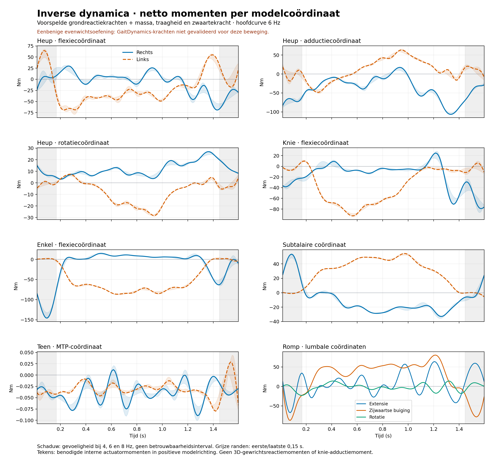
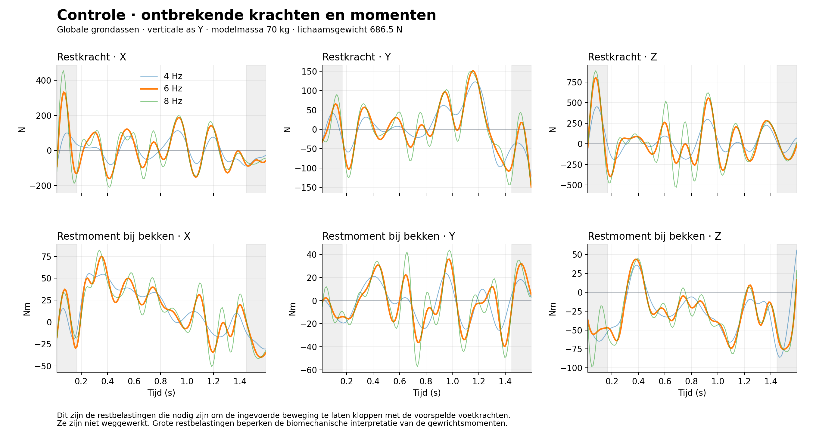

# Inverse dynamica — reproduceerbare eerste proef

**Status, 11 oktober 2026: berekening technisch gecontroleerd, uitkomst uitsluitend diagnostisch.**
De bestaande Pose2Sim/GaitDynamics-demobestanden leveren netto momenten per
bewegingscoördinaat op, inclusief zwaartekracht, segmentmassa's en traagheid.
De restbelastingen zijn echter groot. Deze proef valideert geen klinische
gewrichtsmomenten en is niet toegevoegd aan de Windows-app.

## Correctie: dit is geen loopbeweging

De gebruiker heeft bevestigd dat de geanalyseerde beweging een
**evenwichtsoefening op één been** is. Deze classificatie komt van de gebruiker,
niet uit een automatische bewegingsherkenning. De steunvoet en eventuele
andere steuncontacten zijn nog niet vastgesteld.

GaitDynamics is bedoeld voor loop-/hardloopdynamica. Voor deze evenwichtsoefening
is de betrouwbaarheid van de voorspelde krachten en CoPs niet aangetoond.
De eerdere kracht- en momentgrafieken moeten daarom worden gelezen als een
technische proef met invoer buiten het aangetoonde toepassingsgebied.
Een geslaagde inverse-dynamicaberekening maakt die krachten niet betrouwbaar.
De grote restbelastingen passen bij een mismatch, maar bewijzen niet dat de
bewegingssoort de enige oorzaak is.

Inverse dynamica zelf is ook geschikt voor evenwichtsoefeningen, mits de
beweging, segmentparameters en externe belastingen voldoende betrouwbaar zijn.
De looproute uit het aangehaalde OpenCap-artikel rechtvaardigt geen
GaitDynamics-krachtvoorspelling voor deze oefening.

## Resultaten bekijken

- [Netto momenten: PNG](inverse-dynamica-momenten.png) · [PDF](inverse-dynamica-momenten.pdf)
- [Restkrachten en restmomenten: PNG](inverse-dynamica-restbelastingen.png) · [PDF](inverse-dynamica-restbelastingen.pdf)
- [Hoofdberekening: alle 23 coördinaten, CSV](6Hz/inverse-dynamica.csv)
- [Restbelastingen in globale assen, CSV](6Hz/restbelastingen.csv)
- [Berekeningsrapport met controles, instellingen en SHA256-hashes](berekeningsrapport.json)



Blauw is rechts, oranje links. De hoofdcurves gebruiken 6 Hz. De gekleurde
schaduw toont het bereik van de berekeningen bij 4, 6 en 8 Hz; dit is **geen
betrouwbaarheidsinterval**. De eerste en laatste 0,15 seconde zijn grijs
weergegeven en uitgesloten van de samenvattende statistiek. Ook buiten die
randen is de nauwkeurigheid niet vastgesteld.



Restbelastingen zijn de extra krachten en momenten die nodig zijn om de
opgelegde beweging te laten voldoen aan de bewegingsvergelijkingen met de
ingevoerde voetkrachten. Ze zijn niet gecorrigeerd of weggeoptimaliseerd.

| Filter | Restkracht, RMS van de norm | In % lichaamsgewicht | Restmoment bij bekken, RMS van de norm |
|---|---:|---:|---:|
| 4 Hz | 144,0 N | 21,0% | 47,3 Nm |
| **6 Hz** | **232,1 N** | **33,8%** | **51,6 Nm** |
| 8 Hz | 287,7 N | 41,9% | 55,8 Nm |

Statistiek over **0,16666667–1,44666667 s**, dus zonder de randen.
Bij 6 Hz is de maximale restkrachtnorm in dat interval 591,2 N en de maximale
restmomentnorm 86,8 Nm. RMS betekent hier
`sqrt(mean(Fx² + Fy² + Fz²))`, respectievelijk dezelfde formule voor momenten.
Lichaamsgewicht is `70 × 9,80665 = 686,4655 N`.
De mismatch blijft bij alle drie filters aanwezig. Er is geen universele
acceptatiegrens toegepast; deze grote restbelastingen maken een klinische
interpretatie van deze proef onvoldoende onderbouwd.

## Bewaarde invoer en herkomst

De vier geüploade demobestanden zijn ongewijzigd opgenomen in [invoer](invoer/):

| Bestand | Gebruik |
|---|---|
| [motion.mot](invoer/motion.mot) | Geconverteerde Pose2Sim-beweging: 96 samples, circa 60 Hz, 23 onafhankelijke coördinaten; hoeken in graden, translatie in meter. |
| [ground_reaction_forces.mot](invoer/ground_reaction_forces.mot) | GaitDynamics-export: 159 samples, 100 Hz; krachten in N, CoP in m, zes vrije-momentkolommen met nulwaarden. |
| [model-numerical.osim](invoer/model-numerical.osim) | Model zonder visualisatiemeshes waarmee gerekend wordt; 14 lichamen, 25 coördinaten, 2 koppelingen, geen spieren of andere krachten. |
| [model.osim](invoer/model.osim) | Bijbehorende aangeleverde modelvariant; controle van massa, massamiddelpunt en traagheid. |

Het ook aangeleverde `motion_grf_pred___.mot` is byte-identiek aan
`ground_reaction_forces.mot` en wordt niet nogmaals opgeslagen. SHA256:
`9a05bc496dbfed7501328013de15d6c5fe2baa542ae78f390b60d700c12f19df`.
De invoerhashes staan in het rapport en worden voor en na de berekening gecontroleerd.
De lokale `.gitattributes` voorkomt automatische regel-eindconversie bij
Windows-checkouts, zodat de invoer- en archiefhashes behouden blijven. De
opmaak van modeluploads en upstream-bronbestanden is bewust ongewijzigd.

Dit zijn de bestanden uit de bestaande voorbeeldanalyse, geen nieuwe
webcammeting. Er is geen nieuwe Pose2Sim- of GaitDynamics-run uitgevoerd.
De verwijderde oorspronkelijke Pose2Sim-rug- en armbewegingen kunnen niet
worden gereconstrueerd uit dit gereduceerde model.

## Rekenmethode en vastgelegde keuzes

1. **Modelparameters.** De totale massa is 70 kg en de zwaartekracht is
   `(0, -9,80665, 0)` m/s². Massa's, massamiddelpunten en traagheidsmatrices
   van beide aangeleverde modelvarianten zijn identiek. Alle massa's zijn
   positief en alle traagheidsmatrices positief-definiet. De twee teensegmenten
   hebben echter niet-fysische hoofdtraagheden: de grootste is groter dan de
   som van de andere twee. De oorspronkelijke waarden zijn behouden en de
   afwijking staat per lichaam in het rapport.
2. **Eenheden en tijd.** Hoeken worden omgezet naar radialen en uitgepakt
   (`unwrap`); translaties blijven meters. De 100 Hz-tijdreeks wordt
   gereconstrueerd vanaf het eerste bewegingstijdstip. De opgeslagen
   krachttijden verschillen daarvan maximaal 3,33 microseconde door afronding.
   Er is geen extrapolatie buiten de beweging.
3. **Filtering en versnellingen.** Op de oorspronkelijke circa 60 Hz-beweging
   wordt een vierde-orde Butterworth-filter toegepast, vooruit en achteruit,
   met odd padding. Daarna volgt een interpolerende spline van graad vijf;
   snelheid en versnelling zijn de analytische eerste en tweede afgeleide.
   De nul-fase tweerichtingsfilter heeft een andere effectieve overdracht dan
   één enkele filterpassage. 6 Hz is een proefkeuze, geen bewezen optimaal
   filter; 4 en 8 Hz zijn verplichte gevoeligheidsberekeningen.
4. **Voetkrachten.** `force1` wordt aan `calcn_r` gekoppeld, `force2` aan
   `calcn_l`, overeenkomstig de GaitDynamics-exportconventie van deze keten.
   Krachten en punten staan in globale OpenSim-grondassen; Y is verticaal.
   Per voet wordt de gehele ruwe kracht nul gemaakt wanneer `Fy < 20 N`:
   21 samples rechts, 33 links. GaitDynamics vult de CoP onder deze grens met
   nul; dat is geen bruikbaar grondpunt. Deze drempel is een expliciete
   bewerkingskeuze en geen nauwkeurigheidsbewijs voor de overige CoPs.
5. **Belastingen filteren.** Eerst wordt het moment over de globale oorsprong
   berekend: `M_O = CoP × F`. Vervolgens worden `F` en `M_O` gezamenlijk op
   100 Hz gefilterd, met dezelfde 4/6/8 Hz als de beweging. De CoP wordt niet
   afzonderlijk gefilterd: dat zou de mechanische relatie veranderen.
   De OpenSim-invoer bevat daarom een equivalente kracht bij de globale
   oorsprong plus het moment `M_O`. Dat moment is **geen voorspeld vrij
   contactmoment**. De filters kunnen geringe krachten rondom de
   contactgrenzen en negatieve overshoot veroorzaken; er wordt daarna niet
   opnieuw afgeknipt, omdat dit de gefilterde kracht-momentrelatie zou wijzigen.
6. **Inverse dynamica.** `OpenSim.InverseDynamicsSolver` bepaalt de benodigde
   gegeneraliseerde krachten voor voorgeschreven positie, snelheid en
   versnelling, met zwaartekracht en externe voetbelastingen. Er zijn geen
   spieren, passieve krachten of bestaande actuatoren om dubbel te tellen.
   De 6 bekkencoördinaten blijven vrij voor het rapporteren van restbelastingen.
7. **Gekoppelde knieschijven.** Het model bevat
   `knee_angle_r_beta = knee_angle_r` en dezelfde relatie links. De positie,
   snelheid én versnelling van die afhankelijke coördinaten worden ingevuld.
   De solver negeert de constraint-krachten bij zijn inverse-dynamica-oplossing.
   Daarom wordt voor de onafhankelijke coördinaten de projectie `Jᵀ τ`
   toegepast: `tau_knee = tau_knee_angle + tau_knee_angle_beta`.
   Alleen de ruwe `knee_angle`-kolom gebruiken zou de knieschijfbijdrage missen.
8. **Restmomenten.** Bekken-Eulercoördinaatmomenten zijn niet rechtstreeks
   globale X/Y/Z-momenten. De zes bekkeninspanningen worden via de
   snelheid-Jacobiaan en virtueel vermogen omgezet naar een ruimtelijke
   belasting: `Bᵀ W = tau_bekken`. De gerapporteerde kracht staat in globale
   grondassen; het moment geldt over de actuele oorsprong van het bekken.

## Betekenis van de uitkomsten

`inverse-dynamica.csv` bevat de 23 onafhankelijke coördinaten: 20 momentkolommen
in Nm en 3 bekkenkrachtkolommen in N. Dit zijn **benodigde interne
actuatormomenten in de positieve modelrichting**, inclusief de gezamenlijke
werking die actieve en passieve structuren zouden moeten leveren.
Er wordt geen spierverdeling of spierkracht berekend. Links en rechts worden
niet kunstmatig gespiegeld. Voor rapportage als extern flexie-/extensie- of
adductiemoment moet eerst de anatomische as- en tekenconventie worden gekozen.

De knieflexiecoördinaat levert één netto coördinaatmoment. De andere
kniebewegingen zijn afhankelijk van deze flexie. Dit geeft **geen drie
onafhankelijke knie-actuatormomenten en geen knie-adductiemoment**. Daarvoor is
nog een afzonderlijke analyse van gewrichtsreacties en anatomische projectie
nodig. De eerder gemaakte [GRF-kruisproductgrafieken](../grf-gewrichtsmomenten/)
zijn een andere grootheid en mogen niet als dezelfde momentuitvoer worden gelezen.

Voor de MTP-coördinaten is de beweging in deze demo nul. Hun kleine
momenten zijn alleen diagnostisch: de volledige externe voetbelasting wordt
op de achtervoet (`calcn`) gezet, niet verdeeld over hiel en tenen.

## Wat is getest en wat blijft onzeker?

**Uitgevoerd en geslaagd:**

- Statische controle zonder voetkrachten: benodigde verticale steun is
  686,4655 N; afwijking van lichaamsgewicht kleiner dan `3 × 10⁻¹³ N`.
- Statische controle zonder zwaartekracht: alle inspanningen zijn nul.
- Onafhankelijke Newton-Euler-balans over alle segmenten, inclusief
  massamiddelpunten, traagheidsrotaties en voorgeschreven versnellingen:
  maximale afwijking van de berekende restbelasting kleiner dan
  `3 × 10⁻¹²` in N/Nm, bij alle filters.
- Vermogensbehoud bij de knieschijfprojectie: afwijking kleiner dan
  `2 × 10⁻¹³ W`.
- Standaard `InverseDynamicsTool` uitgevoerd voor 4, 6 en 8 Hz, elk 159 samples.
  Deze tool differentieert zijn eigen GCV-splines van de geëxporteerde
  100 Hz-beweging. In het statistiekinterval is de grootste componentafwijking
  minder dan 0,071 N en minder dan 0,006 Nm over alle filters; detailwaarden
  staan in het rapport. Aan de randen kan het verschil veel groter zijn:
  maximaal circa 178 N. Beide methoden gebruiken dezelfde OpenSim-dynamica;
  dit is een implementatiecontrole, geen onafhankelijke klinische validatie.
- De bronbestanden zijn ongewijzigd gebleven.

**Beperkingen en aannames:**

- De krachten en CoPs zijn modelvoorspellingen; er is geen krachtplaatreferentie.
  De zes vrije contactmomenten zijn onbekend en als nul aangenomen.
- De modelmassa van 70 kg past bij het lichaamsgewicht gebruikt in de
  oorspronkelijke krachtvoorspelling. Het is geen bevestigde persoonsmeting.
- Hoofd, armen en rug zijn voor GaitDynamics samengevoegd tot één starre romp;
  de gezamenlijke inertiële parameters zijn in de neutrale houding bepaald.
  Dat behoudt niet de dynamica van afzonderlijk bewegende armen en rug.
  Dit volgt uit [de bestaande conversiecode](../../../mocap_app/analysis/model_conversion.py).
- De twee teeninertieën zijn niet fysisch realiseerbaar als star lichaam.
  Er is niet stilzwijgend een ander model of andere traagheid gekozen.
- De krachtverdeling over voetsegmenten, de modelantropometrie en de
  anatomische momentconventies zijn niet experimenteel gevalideerd.
- De korte demo duurt 1,58 s. Filter- en spline-effecten zijn vooral aan de
  randen groot; 0,15 s uitsluiten is een diagnostische keuze, geen garantie.
- Grote restbelastingen zijn gemeten, maar de oorzaak is niet vastgesteld.
  Bewegingsversnellingen, krachtvoorspelling, CoP, modelvereenvoudiging en
  ontbrekende vrije momenten zijn mogelijke oorzaken, geen bewezen verklaring.

## Herhalen zonder nieuwe videoanalyse

Gebruik een Python-omgeving met OpenSim 4.6. De proef is daadwerkelijk
uitgevoerd op Linux x86_64 met Python 3.12.14, NumPy 2.5.4, SciPy 1.18.1 en
matplotlib 3.10.3. [requirements.txt](requirements.txt) legt de pakketversies
vast. Er zijn geen AI-gewichten, webcams, GPU, HuCalib-installatie of
GaitDynamics-installatie nodig voor deze berekening. Op Windows is deze
standalone proef nog niet uitgevoerd; het bestaande OpenSim-Python of WSL2
kan daarvoor een startpunt zijn, maar platformwerking is niet bewezen.

Voer vanuit de repositoryhoofdmap uit met de Python van die omgeving:

```bash
python docs/examples/inverse-dynamica/bereken_inverse_dynamica.py \
  --motion docs/examples/inverse-dynamica/invoer/motion.mot \
  --forces docs/examples/inverse-dynamica/invoer/ground_reaction_forces.mot \
  --model docs/examples/inverse-dynamica/invoer/model.osim \
  --numerical-model docs/examples/inverse-dynamica/invoer/model-numerical.osim \
  --output /tmp/hu3d-inverse-dynamica-nieuwe-run
```

Gebruik steeds een **nieuwe** resultaatmap; het script weigert bestaande
resultaten te overschrijven. Het script controleert modelstructuur en tijd,
rekent alle drie filters uit, voert de mechanische controles en standaard-tool
uit en genereert de grafieken en het JSON-rapport. Het script is bewust
beperkt tot deze geconverteerde modelstructuur en de 70 kg-demoproef.
Het is geen generieke analyse voor willekeurige patiëntenmodellen.

De submappen [4Hz](4Hz/), [6Hz](6Hz/) en [8Hz](8Hz/) bevatten:

| Bestand | Inhoud |
|---|---|
| `inverse-dynamica.csv` / `.sto` | De 23 onafhankelijke inspanningen na projectie. |
| `inverse-dynamica-volledig.csv` | Alle 25 ruwe solvercoördinaten, inclusief knieschijven. |
| `restbelastingen.csv` | Globale restkracht en restmoment bij het bekken. |
| `beweging-gefilterd.mot` | Alle 25 voorgeschreven coördinaten in rad/m. |
| `snelheden.csv` / `versnellingen.csv` | Analytische afgeleiden, eenheden in kolomnamen. |
| `externe-belastingen.mot` / `ExternalLoads.xml` | Equivalente, gefilterde grondwrenches en voetkoppeling. |
| `model.osim` / `InverseDynamicsSetup.xml` | Zelfstandige OpenSim-toolconfiguratie met relatieve paden. |
| `opensim-tool-volledig.sto` / `opensim-tool.log` | Ruwe uitvoer en log van de daadwerkelijk uitgevoerde standaard-tool. |

Let op: de standaard-tool noemt `knee_angle_*_beta` een `_force`, omdat
OpenSim deze CustomJoint-coördinaten als gekoppelde beweging classificeert.
Ze zijn hier lineair gelijk aan de knieflexiehoek in radialen; hun inspanning
heeft voor deze projectie dus een momentdimensie. Het script koppelt op
coördinaatnaam en neemt niet blind die automatische kolomachtervoegsels over.
De `.sto`-bestanden van de standaard-tool zijn niet al geprojecteerd.

## Vervolgvolgorde — aangepast na bewegingscorrectie; nog niet uitgevoerd

1. Stel vast welke voet de steunvoet is, wanneer er één of twee voetcontacten
   zijn en of er handsteun of andere externe belastingen zijn. Beoordeel een
   periode met werkelijk één steuncontact afzonderlijk.
2. Gebruik bij voorkeur de oorspronkelijke volledige Pose2Sim-beweging en
   het volledige model. De afzonderlijke arm-/rompbeweging is bij balans
   relevant en is in de aangeleverde gereduceerde bestanden verloren gegaan.
   Controleer ook de twee niet-fysische teeninertieën.
3. Gebruik gemeten krachten als ze beschikbaar zijn. Voor een periode met
   precies één steunvoet, alleen zwaartekracht en geen andere contacten kan
   de totale contactbelasting ook uit de volledige lichaamsdynamica worden
   afgeleid: `F_contact = m (a_COM - g)`. De totale contactmomentvector volgt
   uit de verandering van het impulsmoment en het zwaartekrachtsmoment.
   Daarmee is geen loopgericht AI-krachtmodel nodig.
4. Een CoP en vrij voetmoment volgen niet zonder aanvullende keuzes. Leg de
   contactvlakhoogte en toegestane vrije momentcomponenten vast; controleer
   of de CoP binnen het steunvlak en de krachten binnen fysische contactgrenzen
   liggen. Bij meerdere contacten is de verdeling over die contacten niet
   uniek af te leiden uit alleen de hele-lichaamsbalans.
5. Voer vervolgens inverse dynamica opnieuw uit met die gedocumenteerde
   belastingen en modelkeuzes. Een hele-lichaamsbelasting uit dezelfde beweging
   maakt de globale balans per constructie kloppend; een kleine restbelasting
   is dan **geen onafhankelijke nauwkeurigheidsvalidatie**.
6. Als alleen een benadering nodig is, kan een quasi-statische balans worden
   onderzocht, maar `F ≈ m g` mag niet zonder controle op versnellingen en
   arm-/rompbeweging worden aangenomen. App-integratie blijft een latere stap.

## Bronnen en afbakening tegenover het artikel

[OpenCap Monocular, arXiv:2603.24733v1](https://arxiv.org/abs/2603.24733),
§2.2.5, p. 7: bij lopen voorspelt GaitDynamics krachten, waarna een fysische
simulatie deze voorspellingen volgt om gewrichtsmomenten te bepalen.
De huidige proef voert **voorgeschreven inverse dynamica** uit: er is geen
contactoptimalisatie, bewegingsaanpassing, spieroptimalisatie of
restbelastingreductie. De nauwkeurigheidsclaims uit dat artikel gelden niet
voor deze demo.

De behandeling van de solveruitvoer is gecontroleerd aan de officiële
OpenSim-implementatie:
[InverseDynamicsSolver.cpp](https://github.com/opensim-org/opensim-core/blob/main/OpenSim/Simulation/InverseDynamicsSolver.cpp)
(`calcResidualForceIgnoringConstraints`) en
[InverseDynamicsTool.cpp](https://github.com/opensim-org/opensim-core/blob/main/OpenSim/Tools/InverseDynamicsTool.cpp)
(GCV-splines en uitvoer in mobiliteitsvolgorde).
De op 11 oktober 2026 geraadpleegde bronbestanden zijn ook bewaard in
[bronnen](bronnen/), met hun oorspronkelijke licentietekst. Dit is een snapshot
van upstream `main`, niet een claim dat deze bestanden de exacte gebruikte
binaire build reproduceren. De werkelijk gebruikte OpenSim-build en de
overige versies staan in het rapport. [SHA256SUMS](SHA256SUMS) controleert de bewaarde bestanden; nieuwe
PDF's en logs hoeven door tijd-/metadata niet byte-identiek te zijn.
