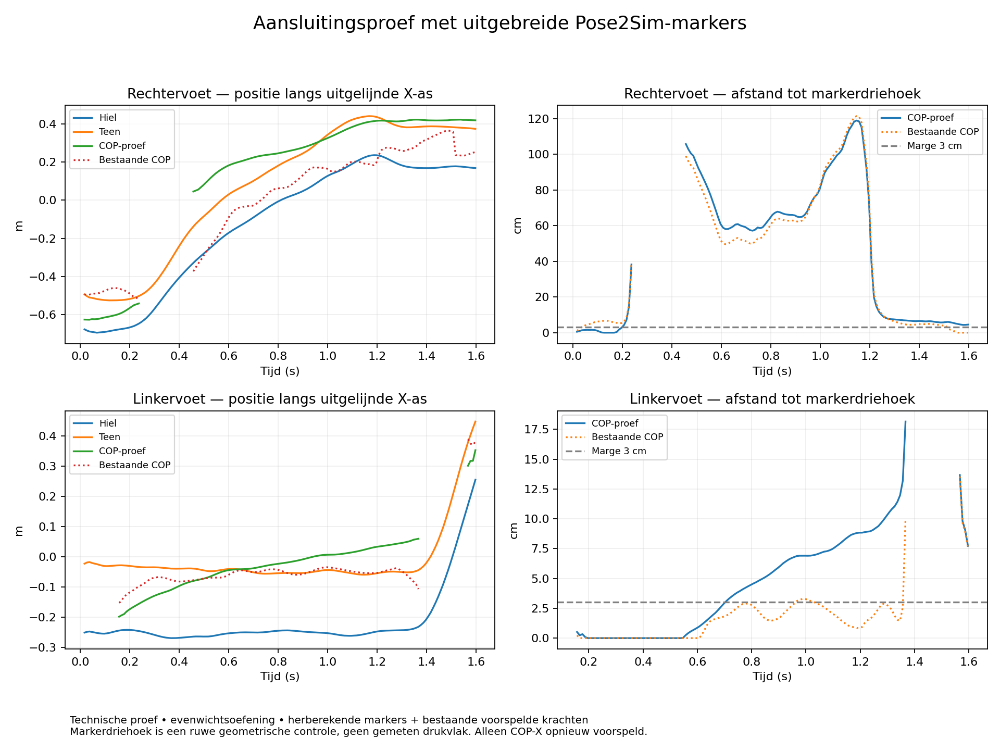

# Aansluitingsproef in de cloud — 12 oktober 2026

**Onderzoeksresultaat; geen gevalideerde krachten of gewrichtsmomenten.**
De app is niet aangepast en de eerder geüploade bronbestanden zijn behouden.

## Uitgevoerd

De oorspronkelijke uitgebreide TRC van de Windows-analyse was niet beschikbaar
in de cloud. Het eerdere CI-artifact bevatte ook geen TRC of oorspronkelijk
geschaald model. Daarom zijn de vier originele Pose2Sim-demovideo's opnieuw
geanalyseerd, op dezelfde vastgelegde broncommit
`68304b47195dac80bc341cdfd9669140609358c4`.

Alle zeven Pose2Sim-stappen zijn op CPU voltooid: detectie, synchronisatie,
persoonskoppeling, triangulatie, filtering, markeruitbreiding en kinematica.
De bekende demo-afwijking in cameraresolutie is uitsluitend diagnostisch
toegestaan. De resultaatfile bevat 96 regels met **65 markers in meters**;
hiel-, teen-, vijfde middenvoets- en bekkenmarkers zijn aanwezig. Dit is echte
marker-augmenter-uitvoer, niet de body-oorsprongproxies van de vorige proef.

Na een nieuwe modelconversie zijn de bewegingscoördinaten met de eerder
geüploade beweging vergeleken. De 96 tijdstippen en kolomnamen zijn gelijk,
maar de waarden zijn niet identiek: maximale verschillen zijn circa 0,00670 m
voor pelvis_tx, 0,00481 m voor pelvis_ty en 0,01861 m voor pelvis_tz; maximale
rotatieverschillen zijn 4,32 graden. Platform-/runtimeverschillen kunnen hierbij
een rol spelen; de precieze oorzaak is niet afzonderlijk vastgesteld.

De bestaande 159 GRF-regels vallen binnen het markerinterval. Er is uitsluitend
binnen dat interval geïnterpoleerd, zonder extrapolatie. Voettoewijzing volgt de
officiële GaitDynamics-code: force1/calcn_r is rechts, force2/calcn_l is links.

## COP-aansluiting

De markerbenamingen zijn in een wegwerpkopie vertaald naar de COP-invoer.
Alle punten en kracht-/momentvectoren zijn met dezelfde rechtshandige rotatie
om de verticale Y-as uitgelijnd. De gemiddelde bekkenrichting uit ASIS/PSIS
geeft hiervoor circa **92,15 graden**. Puntcoördinaten hebben daarbij ook een
gemeenschappelijke horizontale oorsprong; vectoren zijn uitsluitend geroteerd.

Het COP-checkpoint is met de eerder beschreven beperkte NumPy-allowlist geladen.
De eenheidsfout is uitsluitend in een geïsoleerde onderzoeksvariant gecorrigeerd:
na vermenigvuldiging met 1.000 wordt weer door 1.000 gedeeld, niet door 1.000.000.
Er zijn 159 eindige uitvoerregels. Alle krachten, momentkolommen en Y-/Z-COP zijn
in het uitgelijnde frame behouden; **alleen COP-X is opnieuw voorspeld**.
De oorspronkelijke bestanden zijn met hashes gecontroleerd en intact.

De technische aansluitingsstappen werken, maar een geometrische controle
slaagt niet. Tijdens voorspelde steun (verticale kracht >20 N) is de afstand
tot de horizontale markerdriehoek van hiel/teen/vijfde middenvoetsmarker:

| Voet | Steunregels | Meer dan 3 cm buiten markerdriehoek | Mediane afstand | Maximale afstand |
| --- | ---: | ---: | ---: | ---: |
| Rechts | 138 | 119 | 58,5 cm | 119,0 cm |
| Links | 126 | 71 | 4,28 cm | 18,2 cm |

De bestaande COP heeft rechts eveneens een grote mediane afwijking (50,7 cm);
links is die 1,51 cm. Het resultaat wijst dus niet uitsluitend op een nieuwe
COP-X-fout. De module behoudt ook de bestaande laterale COP, die opnieuw moet
worden beoordeeld. De bronbeweging is geen lopen, en de steunmaskers komen uit
nog niet gevalideerde voorspelde krachten. De COP-module normaliseert bovendien
iedere gevonden steunperiode naar 0–100%, ook als deze bij de opnamegrens
onvolledig is. Dit is geen bevestiging van een complete loopsteunfase.

De markerdriehoek is een eenvoudige plausibiliteitscontrole, geen gemeten
drukvlak of exacte schoengeometrie. De gekozen 3 cm is een diagnostische marge,
geen klinisch gevalideerde grens. De combinatie van herberekende markers en
oude krachten is bovendien een proef tussen twee niet exact identieke runs.
De grote afwijkingen rechtvaardigen nader onderzoek, maar bewijzen niet hoe
nauwkeurig deze modellen op geschikte loopdata zijn.



## Oorspronkelijk model en voetcontacten

Het opnieuw geschaalde volledige Pose2Sim-model bevat 56 modelmarkers, 318
spieren en **al twaalf SmoothSphereHalfSpaceForce-contacten** plus dertien
contactgeometrieën. De 65 trajectmarkers en 56 modelmarkers zijn verschillende
verzamelingen; niet iedere trajectmarker hoeft een modelmarker te zijn.
Het gereduceerde GaitDynamics-model had die gegevens verwijderd.

De upstream contactgenerator is geïsoleerd op een kopie van het volledige
model uitgevoerd. De patellamassa's zijn voor deze proef behouden. De routine
kan de voetgeometrie en schaalinformatie nu vinden en de kopie initialiseren,
maar voegt twaalf contacten toe aan de twaalf die al bestaan. Daardoor ontstaan
24 contactkrachtelementen. **Deze kopie mag niet voor dynamica worden gebruikt.**
Een latere voorbereiding moet bestaande contacten beoordelen en hergebruiken
of vervangen, niet eenvoudig nog een set toevoegen. De aanwezige contacten
hebben onder andere stijfheid 1.000.000; dat is een modelparameter, geen
gemeten eigenschap van de opname. Geen volledige contactsimulatie is uitgevoerd.

## Beperking van nieuwe krachtvoorspelling

De normale GaitDynamics-download via `media.githubusercontent.com` kreeg een
HTTP 403 van de netwerkproxy. Het door de auteurs gelinkte Hugging Face-model
was eveneens geblokkeerd. Er zijn geen ongecontroleerde alternatieve gewichten
gebruikt en geen gegevens naar een hosted inference-dienst verstuurd.
Daarom zijn geen nieuwe krachten voor deze opnieuw berekende beweging gemaakt.
De bestaande gebruikers-GRF is met bovenstaande beperking hergebruikt.

## Conclusie en vervolgstap

De marker augmenter biedt de benodigde invoer en de cloud kan de 3D-route
volledig opnieuw berekenen. Het volledige Pose2Sim-model bevat ook de benodigde
soort contactgegevens. De COP-uitkomst is op deze evenwichtsoefening echter
onvoldoende plausibel om zonder verdere controle gewrichtsmomenten als resultaat
aan te bieden.

De eerstvolgende controle is een **exact bij elkaar horende oorspronkelijke
TRC, beweging, model en GRF**, of een volledig nieuwe berekening inclusief GRF.
Controleer daarbij vooral de bestaande laterale COP, voetcontactfasen,
incomplete steunperioden en de voet-grondhoogte. Volg daarna pas met een
torque-driven simulatie met één gecontroleerde set contacten. Voor nauwkeurigheid
blijft geschikte loopdata met gemeten krachten nodig.

Deze map bewaart de herberekende TRC, het volledige model en de beweging zodat
die bij een vervolg beschikbaar zijn. `connection-report.json` en
`contact-report.json` bevatten de afzonderlijke controles. `SHA256SUMS` legt de
bestanden vast. De modellen en demo zijn afkomstig uit Pose2Sim; zie de
BSD-licentie en herkomst in `testdata/pose2sim-demo` van deze repository.

## Onderzoeksproef herhalen

`check.py` is een zelfstandig onderzoeksbestand en geen appadapter. Het heeft
PyTorch, NumPy, pandas, SciPy en matplotlib nodig. Geef het een **nieuwe**
uitvoermap; het programma weigert een bestaande map. De onderstaande opdracht
is in de cloud uitgevoerd en gaf hetzelfde rapport als de eerste proef:

```bash
MPLCONFIGDIR=/workspace/artifacts/matplotlib-cache /workspace/gaitdynamics-venv/bin/python \
  /workspace/HuCalib/docs/examples/opencap-grf/cloud-connection/check.py \
  --project /workspace/artifacts/cloud-connection-pose2sim/project \
  --inputs /workspace/HuCalib/docs/examples/inverse-dynamica/invoer \
  --candidate /tmp/opencap-processing-grf-audit \
  --reconverted-motion /workspace/artifacts/cloud-connection-reconverted/motion.mot \
  --output /workspace/artifacts/cloud-connection-reproduction
```

Voor een volgende herhaling moet de uitvoermap een andere, nog niet bestaande
naam krijgen. De gebruikte upstreamcheckout moet op de hierboven genoemde
commit staan. Voor een nieuwe Pose2Sim-demoberekening zijn de bestaande scripts
`tools/prepare_windows_demo.py` en `mocap_app.analysis.pose2sim` gebruikt met de
vastgepinde demo, CPU/ONNX Runtime en de diagnostische resolutieoptie.
Voor deze proef is `/workspace/retarget-venv` aangevuld met Pose2Sim vanaf de
lokale checkout, RTMLib, ONNX Runtime en de gebruikte analyseafhankelijkheden.
Er zijn geen nieuwe instellingen of dependencies aan de Windows-app toegevoegd.
