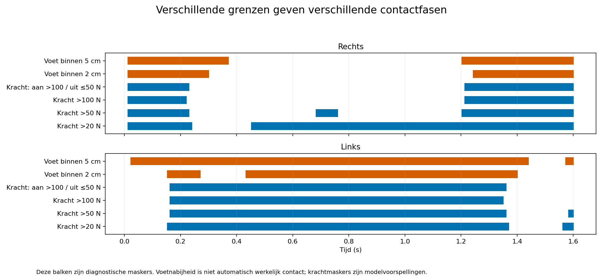
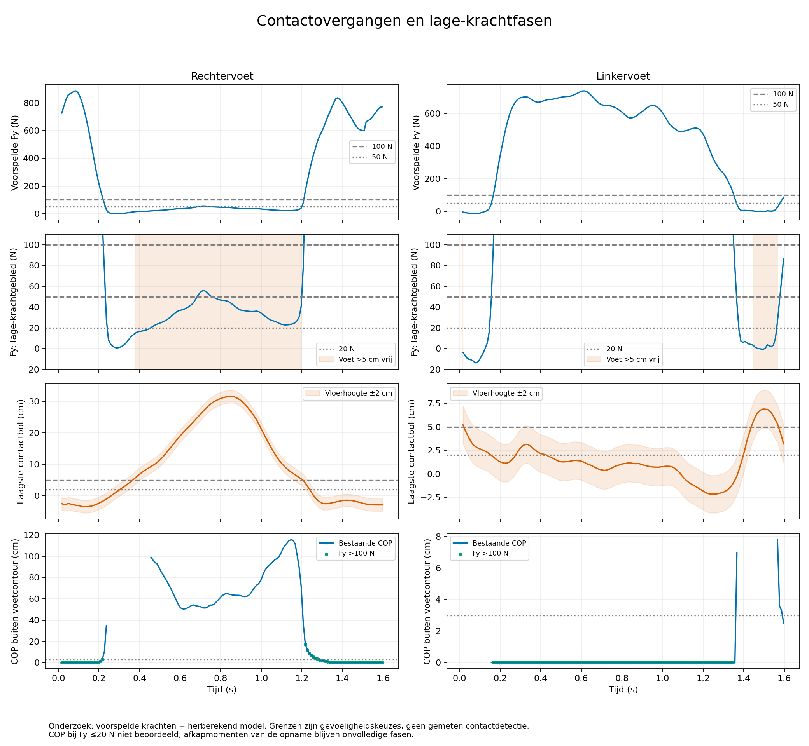

# Contactovergangen en lage-krachtfasen

Cloudonderzoek van 12 oktober 2026, voortbouwend op de
[controle met voetgeometrie](../refined-contact/README.md).
Er zijn geen krachten aangepast, geen COP-punten verplaatst en geen appfuncties
gewijzigd. Dit is een onderzoek naar de interpretatie van de bestaande data,
geen gevalideerde contactdetector of nieuwe gewrichtsmomentberekening.

## Kernbevinding

De grote rechter-COP-afwijkingen liggen vooral in de fase waarin de rechtervoet
omhoog is en nog een kleine voorspelde restkracht heeft. Ook de acht afwijkingen
boven 100 N liggen allemaal binnen 100 ms van de twee 100 N-krachtovergangen.
Bij sterkere belasting buiten die vensters ligt het bestaande COP van beide
voeten binnen de ruime modelcontour, inclusief de diagnostische marge van 3 cm.
Dit betekent geometrische samenhang onder deze aannames, geen bewijs van
nauwkeurige krachten of netto gewrichtsmomenten.

## Wat precies is onderzocht

Invoer is uitsluitend de reeds openbare `refined-contact/controle.csv` van
de eerdere proef. Die combineert het opnieuw berekende volledige Pose2Sim-model
met de eerder geüploade voorspelde krachten. De runs zijn niet bit-identiek;
bekende verschillen lopen op tot circa 1,9 cm en 4,3 graden. De contactbollen
en modelvloer zijn schattingen; er is geen gemeten voetcontact beschikbaar.

Er zijn 159 tijdstappen met interval 0,01 s. Die rasterstap geeft geen
meetnauwkeurigheid van 10 ms: de modelbeweging komt uit 60 Hz-video en de
krachten zijn geresamplede voorspellingen. Drempelpassages zijn alleen voor
de vergelijking lineair tussen aangrenzende stappen geïnterpoleerd. Het zijn
geen gemeten heel strikes, toe offs of camera-/sensortijdvertragingen.

De positiecontrole gebruikt de onderkant van de laagste contactbol per voet.
De COP-controle gebruikt de ruime horizontale contactgeometrie uit de vorige
proef. Grenzen van 20/50/100/200 N, voethoogtes 2/5/7 cm en vloerhoogte ±2 cm
zijn **gevoeligheidskeuzes**, geen definitieve detectorparameters.

## Overgangen rechts

| Signaalgrens | Tijd, ongeveer |
| --- | ---: |
| Voorspelde rechterkracht daalt onder 100 N | 0,221 s |
| Onderkant rechtermodelvoet stijgt boven 2 cm | 0,303 s |
| Rechtermodelvoet >5 cm vrij | 0,377–1,197 s |
| Voorspelde rechterkracht stijgt boven 100 N | 1,209 s |
| Onderkant rechtermodelvoet keert terug binnen 2 cm | 1,238 s |

Ontlasten gaat volgens deze gekozen grenzen ongeveer 82 ms vooraf aan de
2 cm-hoogtegrens. Opnieuw belasten gaat ongeveer 29 ms vooraf aan de terugkeer
binnen 2 cm. Deze verschillen zijn niet als synchronisatiefout vastgesteld.
Met ±2 cm vloerwijziging verschuift de eerste hoogtepassage naar circa
0,260–0,347 s en de terugkeer naar circa 1,217–1,259 s. Een tijdsverschuiving
van de krachtcurve zou daarom zonder verdere onderbouwing onterecht zijn.

Een enkele krachtgrens kan schijncontacten geven:

- Bij >20 N lijkt rechts vanaf 0,457 s opnieuw belast, terwijl de voet nog
  boven de grond is.
- Bij >50 N verschijnt een extra interval van 0,687–0,757 s midden in de
  opgetilde fase.
- Bij >100 N blijven twee hoofdfasen over: aan het begin en vanaf circa
  1,217 s. De hogere grens kan echter echte lichte contacten missen.

Een diagnostische hystereseproef (contactkandidaat aan boven 100 N, uit bij
50 N of minder) geeft rechts 0,017–0,227 s en 1,217–1,597 s, links
0,167–1,357 s. Het 50 N-interval midden in de opgetilde fase wordt daarmee
niet als nieuw contact aangemerkt. Deze keuze is niet in de app ingebouwd en
is geen gevalideerde detector. De eerste rechterfase begint vóór het beschikbare
venster en de laatste loopt door aan het einde: beide zijn onvolledige fasen.



## Lage kracht en COP

| Voet en krachtgebied | Regels | COP meer dan 3 cm buiten voetcontour | Mediane afstand |
| --- | ---: | ---: | ---: |
| Rechts, 20–50 N | 68 | 68 | 69,6 cm |
| Rechts, 50–100 N | 10 | 10 | 52,2 cm |
| Rechts, >100 N | 60 | 8 | 0 cm |
| Links, 20–50 N | 4 | 3 | 5,3 cm |
| Links, 50–100 N | 3 | 1 | 2,5 cm |
| Links, >100 N | 119 | 0 | 0 cm |

De ondergrens is exclusief en bovengrens inclusief. Bij Fy<=20 N wordt het COP
hier **niet beoordeeld**: de upstreamuitvoer zet het daar doorgaans op nul,
wat geen echt drukpunt bij de wereldoorsprong is. De nieuwe tabel laat de
COP-afstand in die regels leeg, in plaats van grote afstand tot dat nulpunt
als COP-fout te tellen.

Rechts zijn 75 regels met 20<Fy<=100 N en een modelvoethoogte >5 cm; 71 blijven
over bij >7 cm, dus ook na een 2 cm hogere vloer blijft het grootste deel
duidelijk opgeheven volgens het model. Links is één zo'n regel boven 5 cm en
geen boven 7 cm. De linkercontactclassificatie is veel gevoeliger voor de
precies gekozen vloerhoogte: 112 van 159 linkerregels liggen in het gebied
waarin een ±2 cm vloerwijziging de 2 cm-nabijheidsclassificatie kan veranderen.
Rechts zijn dat twaalf regels.

In de COP-rekenregel wordt een moment gedeeld door de normale kracht. Kleine
restkrachten kunnen zo grote COP-afstanden geven zonder dat de totale kracht
groot is. Dat maakt het COP bij lage kracht onzeker; het bewijst niet dat de
restkracht exact nul hoort te zijn. Ook een kleine kracht kan via een grote
hefboom een relevante bijdrage aan externe momenten geven. De krachten zijn
daarom niet automatisch gewist of naar de andere voet verplaatst.



## Sterkere belasting buiten overgangsvensters

Afwijkingen zijn vergeleken met afstand tot de 100 N-krachtgrenspassages.

| Halfbreedte overgangsvenster | Rechts: COP-afwijkingen >3 cm boven 100 N binnen / buiten venster | Links: binnen / buiten |
| --- | ---: | ---: |
| 50 ms | 6 / 2 | 0 / 0 |
| 100 ms | 8 / 0 | 0 / 0 |
| 150 ms | 8 / 0 | 0 / 0 |

Buiten de 100 ms-vensters zijn er veertig rechter- en 99 linkerregels boven
100 N; geen daarvan heeft een COP meer dan 3 cm buiten de ruime contour.
Het 100 ms-venster is niet een algemene aanbevolen afkapregel. De vergelijking
laat zien dat de resterende geometrische afwijkingen bij sterkere belasting
geconcentreerd zijn rond overgangen, waar vloer-/modelpositie, voorspeller en
de twee niet-identieke runs extra onzekerheid geven.

## Gevolg voor gewrichtsmomenten

Voor een volgende diagnostische dynamica-analyse moeten per voet ten minste
de volgende waarschuwingen worden behouden:

1. **Fy<=20 N:** COP niet interpreteren als geldig aangrijpingspunt.
2. **20<Fy<=100 N:** lage-krachtfase; COP en contactfase afzonderlijk controleren.
3. **Voet vrij met voorspelde kracht:** mogelijke restkracht of model-/vloerfout;
   niet automatisch een steuncontact.
4. **Rond contactovergangen:** afzonderlijk rapporteren, met gevoeligheid voor
   vensterbreedte, krachtdrempel en vloerhoogte.
5. **Sterkere belasting buiten overgangen:** geometrisch plausibeler, maar
   krachtgrootte, versnellingen, restkrachten en netto momenten blijven
   ongevalideerd. Een andere voet met onzekere krachten kan de totale dynamica
   nog steeds beïnvloeden.

Er wordt hier dus geen "betrouwbaar momentvenster" gecertificeerd. De nuttigste
volgende proef is een diagnostische torque-driven of inverse-dynamica-vergelijking
met deze faselabels zichtbaar, waarbij originele krachten behouden blijven en
eventuele alternatieve contactaannames uitsluitend als gevoeligheidsscenario's
worden vergeleken. Een exact bij elkaar horende beweging en krachtvoorspelling
blijft daarvoor beter dan de huidige combinatie van twee runs.

## Bestanden en herhalen

`fasecontrole.csv` bevat beide voeten afzonderlijk: 318 regels, 159 per voet.
Daarin staan de kracht, modelhoogte, COP-beoordeelbaarheid, diagnostische fase,
hystereseproef, afstand tot krachtgrenspassage en vloerhoogtegevoeligheid.
`rapport.json` bevat de intervallen en gevoeligheidsproeven.

`transitions.py` is een onderzoeksprogramma, geen onderdeel van de app.
Het gebruikt uitsluitend openbare gegevens uit de eerdere GitHub-documentatie.
De oorspronkelijke tabel wordt alleen gelezen en met een hash gecontroleerd.
Kies een nieuwe uitvoermap:

```bash
MPLCONFIGDIR=/workspace/artifacts/matplotlib-cache /workspace/retarget-venv/bin/python \
  docs/examples/opencap-grf/contact-transitions/transitions.py \
  --input docs/examples/opencap-grf/refined-contact/controle.csv \
  --output /workspace/artifacts/contact-transition-new
```

De invoer komt uit de officiële Pose2Sim-demo met eerder berekende krachten,
geen nieuwe persoonlijke opname. Deze oefening is geen lopen en valideert
de voorspellers niet voor dit bewegingsdomein. Bestanden zijn vastgelegd in
`SHA256SUMS`.
