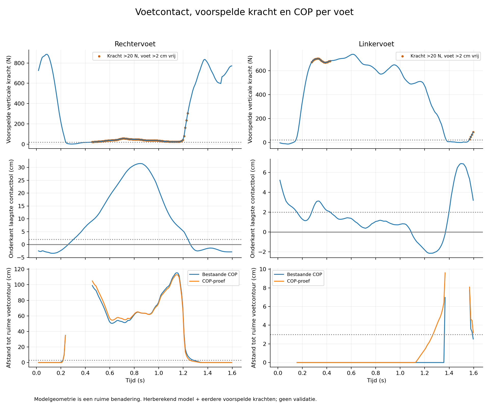
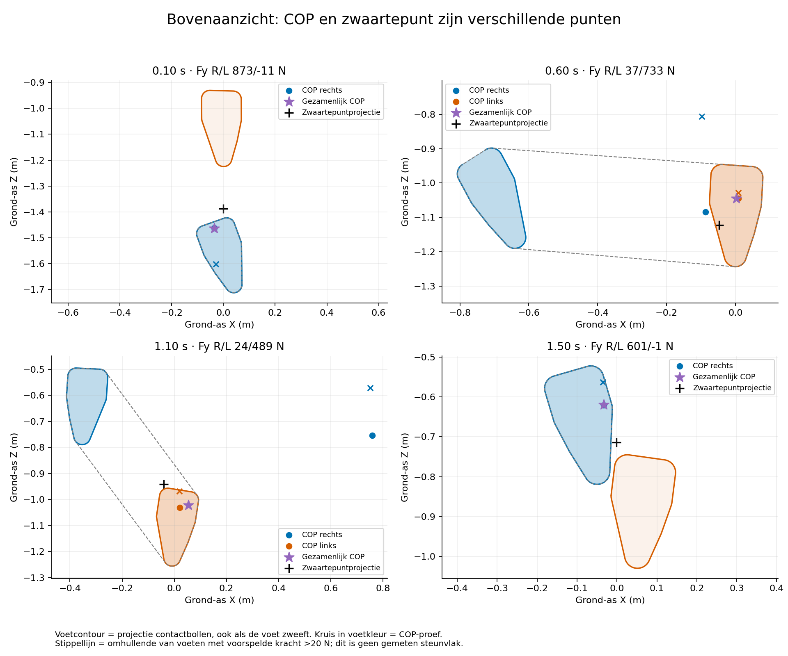
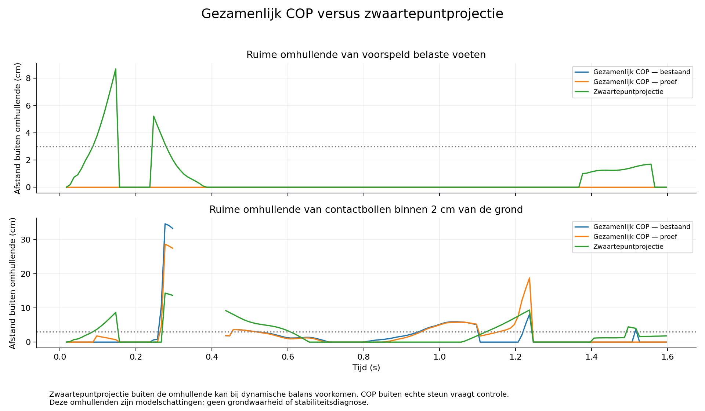

# COP, voetcontact en zwaartepunt: verfijnde controle

Uitgevoerd in de cloud op 12 oktober 2026. Geen appwijzigingen en geen volledige
dynamische simulatie. Alle oorspronkelijke bestanden zijn met hashes gecontroleerd
en intact. De bevindingen zijn diagnostisch, niet klinisch gevalideerd.

## Wat anders is dan de vorige controle

De kleine hiel-/teen-/middenvoetsmarkerdriehoek is vervangen door de geometrie
van de **twaalf bestaande contactbollen** van het volledige Pose2Sim-model:
zes per voet, elk met straal 3,2 cm. De bolcentra worden met de volledige
modelbeweging naar het wereldstelsel getransformeerd. De horizontale projecties
van de hele bollen worden convex omhuld. Dit geeft bewust een **ruime potentiële
voetcontour**, ook als een voet boven de grond hangt. Het is geen exacte
schoenzool of gemeten drukvlak. Omhulling van de cirkels gebruikt 64 punten per
bol; de geometrische discretisatiefout is veel kleiner dan de 3 cm controlemarge.

Daarnaast zijn berekend:

- De afstand van de onderkant van de laagste bol per voet tot de modelvloer Y=0.
- Het COP per voet, zowel de bestaande GaitDynamics-uitvoer als de vorige
  COP-proef. Die proef verandert alleen X in het uitgelijnde frame.
- Het gezamenlijke COP op de vloer, uit de resulterende krachten en momenten.
- Het lichaamszwaartepunt uit alle segmentmassa's en -posities van het volledige
  70 kg-model, met zijn horizontale projectie.

Het model en de beweging zijn herberekend uit dezelfde officiële demo. De
krachten zijn de eerder geüploade gebruikersuitvoer. Deze twee runs zijn niet
bit-identiek: eerder gevonden bewegingsverschillen lopen op tot 1,9 cm en 4,3°.
De huidige proef gebruikt dus geen volledig opnieuw berekende, bij elkaar
horende krachtvoorspelling. Zie [de oorspronkelijke cloudproef](../cloud-connection/README.md).

## Bevindingen per voet

Met voorspelde verticale kracht >20 N en een diagnostische marge van 3 cm:

| Bestaande COP | Rechts | Links |
| --- | ---: | ---: |
| Regels met voorspelde belasting | 138 | 126 |
| COP meer dan 3 cm buiten ruime voetcontour | 86 | 4 |
| Mediane afstand tot voetcontour | 51,8 cm | 0 cm |
| Maximale afstand | 115,4 cm | 7,8 cm |
| Voet >5 cm boven modelvloer terwijl kracht >20 N | 75 | 1 |

**De ruimere controle corrigeert de eerdere te strenge beoordeling van links.**
De oorspronkelijke linkervoet-COP ligt meestal binnen de modelcontour. Rechts
blijven grote afwijkingen, vooral wanneer de voet duidelijk omhoog is en er
nog een kleine voorspelde restkracht overblijft. Rechts loopt de modelafstand
tot de vloer op tot 31,5 cm. Bij meer dan 5 cm voethoogte en kracht >20 N is
de mediane rechterkracht 36,0 N en het maximum 56,0 N.

De extra COP-module lost dit niet op. Met dezelfde controle heeft de proef
rechts 82 en links 14 regels meer dan 3 cm buiten de contour. Er is geen bewijs
dat deze module voor deze evenwichtsoefening beter is dan de bestaande COP.



## Waarom de krachtdrempel belangrijk is

| Krachtdrempel voor beoordelen van bestaande COP | Rechts: buiten 3 cm / beoordeeld | Links: buiten 3 cm / beoordeeld |
| --- | ---: | ---: |
| 20 N | 86 / 138 | 4 / 126 |
| 50 N | 18 / 70 | 1 / 122 |
| 100 N | 8 / 60 | 0 / 119 |
| 200 N | 6 / 57 | 0 / 114 |

Bij kleine normale kracht is een berekend COP gevoelig voor kleine fouten:
het moment wordt gedeeld door die kracht. De officiële GaitDynamics-code maakt
het COP pas nul onder 20 N. Er kunnen dus bij 20–50 N op een opgetilde voet nog
grote, moeilijk interpreteerbare COP-afstanden ontstaan. Het onderzoek laat
een sterke afhankelijkheid van die grens zien.

Dit is **geen aanbeveling om zomaar een drempel van 100 N in te voeren**. Daarmee
kunnen ook echte lichte contacten verdwijnen. Er zijn nog acht rechterpunten
buiten de marge boven 100 N. Kracht, geometrische nabijheid tot de vloer en de
contactovergang moeten gezamenlijk worden beoordeeld, met expliciete onzekerheid.
Er zijn ook dertien linkerregels met negatieve voorspelde normale kracht; die
zijn niet als dragend voetcontact geïnterpreteerd.

## Gezamenlijk COP en zwaartepunt

Het gezamenlijke COP blijft in alle 159 regels binnen de ruime omhullende van
de voeten die volgens de krachten >20 N dragen. Dat bewijst niet dat het echte
steunvlak klopt: deze omhullende bevat ook een **opgetilde voet als die onterecht
een voorspelde kracht heeft**. Ook wordt een groot individueel COP-probleem
door een kleine kracht relatief weinig meegewogen.

Daarom is een tweede, onafhankelijke omhullende gemaakt van alleen contactbollen
waarvan de onderkant binnen 2 cm van de modelvloer ligt (ook kleine penetraties
worden meegenomen). Voor 146 regels is zo'n omhullende beschikbaar. Daar ligt
het bestaande gezamenlijke COP bij 30 regels meer dan 3 cm buiten, maximaal
34,6 cm; de COP-proef bij 35 regels, maximaal 28,7 cm. De andere dertien regels
hebben geen bol binnen die gekozen grens en worden niet van een verzonnen
steunvlak voorzien.

De zwaartepuntprojectie kan bij dynamische balans buiten het steunvlak liggen;
dat is niet hetzelfde als een onmogelijk voet-COP en geeft op zichzelf geen
stabiliteitsdiagnose. In onze modelbenadering ligt die projectie bij elf regels
meer dan 3 cm buiten de krachtgeselecteerde omhullende, en bij 42 van de 146
beoordeelbare regels buiten de grondnabije omhullende.





### Rekenkundige definitie

Alle gegevens worden in hetzelfde oorspronkelijke wereldstelsel beoordeeld.
De COP-proef is eerst uit het uitgelijnde stelsel teruggetransformeerd.
Voor voeten met Fy>20 N wordt berekend:

```text
F = som van de geselecteerde voetkrachten
M = som van (COP_voet × F_voet + vrij voetmoment), ten opzichte van wereldoorsprong
COP_vloer = (M_z / F_y, 0, -M_x / F_y)
```

Hiermee worden ook de opgegeven COP-hoogte en horizontale krachten verwerkt.
Een alleen met Fy gewogen puntgemiddelde is exact voor coplanaire contacten
zonder relevante vrije momenten; de input-COP-hoogtes zijn hier niet allemaal
nul. Het verschil tussen puntgemiddelde en bovenstaande vloerresultante is in
deze proef maximaal 8,9 mm. De rekenregel is afzonderlijk gecontroleerd met
analytische voorbeelden van twee verticale krachten en een kracht op hoogte.

De gezamenlijke COP is hier een **resultante van de geselecteerde voorspellingen**,
geen drukmeting. Positieve voetkrachten <=20 N en negatieve normale krachten
zijn uitgesloten. De maximaal uitgesloten positieve verticale kracht is 2,71%
van de totale positieve verticale kracht. De oorspronkelijke waarden zijn
niet overschreven.

## Onzekerheid van vloer en contact

De modelvloer en contactbollen zijn aannames, geen uit deze opname gemeten
schoengeometrie. Sommige bollen komen circa 2–3,4 cm onder de modelvloer.
Daarom is ook gevoeligheid voor een vloerhoogteverschil van ±2 cm bekeken.
Het aantal regels met voorspelde belasting en voet >2 cm vrij wordt rechts
81/79/77 voor vloerniveaus -2/0/+2 cm. Links is dat 98/20/2. Links is deze
classificatie dus zeer gevoelig voor de precieze vloerhoogte, rechts veel minder.
Ook de herberekeningsverschillen van circa 1,9 cm kunnen bij kleine hoogtes
relevant zijn. De 31,5 cm rechtervoetverheffing verdwijnt niet door zo'n kleine
vloerwijziging.

## Conclusie en nuttigste vervolgstap

Een markerdriehoek alleen was onvoldoende. De modelgeometrie geeft links een
veel plausibeler beeld en maakt het onderscheid tussen COP per voet, gezamenlijk
COP en zwaartepunt zichtbaar. Het voornaamste resterende probleem is de
**kracht-/contactverdeling tijdens lage-krachtfasen en overgangen**, niet het
ontbreken van Pose2Sim-markers.

Voordat nieuwe gewrichtsmomenten worden geïnterpreteerd, moeten modelvloer,
contactgeometrie en kracht-/contactfasen op één exact bij elkaar horende set
worden gecontroleerd. Een volgende torque-driven proef moet onzekere voetcontacten
en pelvisrestkrachten expliciet rapporteren, niet deze momenten presenteren als
gevalideerde uitkomsten. Deze evenwichtsoefening blijft buiten de eerder
bevestigde looptoepassing van de voorspellers.

## Bestanden en herhalen

`rapport.json` bevat de controles en gevoeligheidsproeven. `controle.csv` bevat
alle 159 tijdstappen. `refine.py` is een los onderzoeksprogramma, geen appfunctie.
De diagnostische COP-proef in het uitgelijnde stelsel moet met het onderzoeksprogramma
van de eerdere aansluitingsproef worden gegenereerd en mag niet als gevalideerde
krachtmeting worden gebruikt. Dit nieuwe verslag publiceert dat MOT-bestand niet.
De overige bronbestanden zijn op de eerdere openbare GitHub-commit `9aeddbe`
opnieuw opgehaald en byte voor byte met de lokale bestanden vergeleken:
krachten, volledige model, beweging en aansluitingsrapport waren identiek.
De nieuwe grafieken en tabel zijn analyses van die reeds openbare demo-uitvoer.

De proef kan worden herhaald met OpenSim, NumPy, SciPy en matplotlib:

```bash
MPLCONFIGDIR=/workspace/artifacts/matplotlib-cache /workspace/retarget-venv/bin/python \
  docs/examples/opencap-grf/refined-contact/refine.py \
  --source docs/examples/opencap-grf/cloud-connection \
  --forces docs/examples/inverse-dynamica/invoer/ground_reaction_forces.mot \
  --experimental /workspace/artifacts/cloud-connection-check/cop-aligned-experimental.mot \
  --output /workspace/artifacts/refined-contact-new
```

Voer dit uit vanuit de HuCalib-checkout en kies een nieuwe uitvoermap. De code
weigert een bestaande map. De bestandsinhoud is vastgelegd in `SHA256SUMS`.
