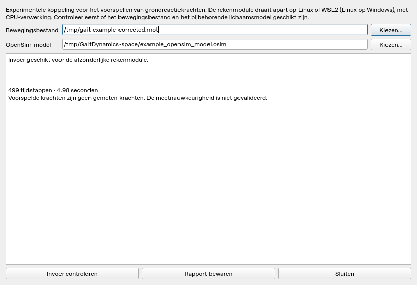

# Experimentele GaitDynamics-koppeling

Na een geslaagde Pose2Sim-analyse biedt **GaitDynamics voorbereiden** een
invoercontrole van het MOT-bestand en het bijbehorende OpenSim-model. Deze
controle draait in de Windows-app, zonder GaitDynamics te installeren.
Met **Pose2Sim-model converteren…** maak je nu ook een passend model en
bewegingsbestand. Dit gebruikt je bestaande Pose2Sim-Python met OpenSim;
er is voor de conversie geen nieuwe Python-installatie nodig.

De eerste rekenmodule voorspelt grondreactiekrachten en aangrijpingspunten
voor beide voeten, met de officiële refinement-gewichten op CPU. Ze draait
apart op Linux. Voor lokaal gebruik op een Windows-computer is **WSL2** de
beoogde route: dat is een Linux-omgeving op dezelfde computer. Native Windows
wordt niet ondersteund, omdat nimblephysics geen Windows-wheels publiceert.
De Windows-app biedt nu een begeleide WSL2-installatie en start de
krachtberekening vanuit het venster. De daadwerkelijke rekenmodule blijft
binnen WSL2 draaien; je hoeft daarvoor geen Linux-opdrachten in te voeren.

## Installeren en gebruiken op Windows

1. Pak de **nieuwe** Windows-testbuild uit in een korte lokale map, bijvoorbeeld
   `C:\HU3D`. Een eerdere testbuild bevat deze knoppen nog niet.
2. Open `Installeer-GaitDynamics.cmd`, of kies in de app
   **Analyse → GaitDynamics installeren…**. Klik op **Controleren** en daarna
   **Installeren / doorgaan**. Dit is optioneel; Pose2Sim werkt ook zonder WSL2.
3. Accepteer de Windows-beheerderstoestemming als die verschijnt. De app roept
   Microsofts `wsl --install --no-distribution` aan voor de Windows-onderdelen.
   Herstart Windows als de installatie daarom vraagt. Open daarna hetzelfde
   installatievenster en klik opnieuw op **Installeren / doorgaan**.
   De app controleert wat al aanwezig is en bewaart de installatiestatus.
   Ubuntu 24.04 wordt daarna zonder interactieve eerste start onder jouw
   gewone Windows-account geïnstalleerd. De app controleert daarna WSL2 en
   zet uitsluitend een zojuist nieuw geïnstalleerde WSL1-distributie om naar WSL2.
4. Wacht tot **GaitDynamics is gereed** verschijnt. De app installeert een
   afzonderlijke Python 3.12-omgeving, CPU-PyTorch en nimblephysics binnen
   Ubuntu. Beide AI-modellen worden met vastgelegde SHA256-hashes gecontroleerd.
   Bestaande correcte downloads worden hergebruikt na een onderbreking.
5. Na je Pose2Sim-analyse: **GaitDynamics voorbereiden → Pose2Sim-model
   converteren… → Krachten voorspellen…**. Vul de werkelijke lichaamslengte
   in meters en massa in kg in. Bandsnelheid is **0** bij wandelen over de grond.
   Kies een map voor nieuwe resultaten; bestaande resultaten worden niet overschreven.
6. Klik na afloop op **Krachten bekijken** voor de zes krachtcomponenten van
   beide voeten, of **Resultaatmap openen**. `ground_reaction_forces.mot` bevat
   krachten (N) en aangrijpingspunten (m); `gaitdynamics.json`,
   `environment.json` en `windows-transport.json` leggen invoer en verwerking vast.
   Vrije momenten worden niet voorspeld; de upstream torque-kolommen bevatten nullen.

Er is geen handmatige Linux-accountregistratie nodig: de app gebruikt een
afzonderlijke systeemgebruiker `hu3d-gait`, uitsluitend via `wsl --exec`.
De rekenomgeving staat onder `/opt/hu3d-gaitdynamics`. Een al aanwezige
**Ubuntu 24.04 met WSL2** wordt gebruikt; daarin voegt de app systeempakketten
toe. Andere distributies en bestaande Python-omgevingen blijven behouden.
Een bestaande Ubuntu 24.04 met WSL1 wordt niet automatisch omgezet.
De draagbare testbuild heeft geen installatieprogramma dat WSL2 stilzwijgend
installeert: je start de expliciete wizard vanuit de app of via het CMD-bestand.

### Vereisten, fouten en testgrenzen

Windows 10/11 x64 moet WSL2 ondersteunen, met hardwarevirtualisatie ingeschakeld.
Reserveer 10 GB schijfruimte. Voor de eerste installatie is internet nodig naar
Microsoft/Ubuntu, PyPI, `download.pytorch.org`, `raw.githubusercontent.com` en
`media.githubusercontent.com`. Een beheerder of bedrijfsbeleid kan installatie
blokkeren. Zonder toestemming wordt geen succesvolle installatie gemeld.
De app herstart Windows niet automatisch en verwijdert geen distributies.
Gebruik lokale bestanden; UNC-netwerkpaden worden afgewezen.

Installatie- en transportfouten staan in
`%LOCALAPPDATA%\HU3D-kinematics\GaitDynamics\setup.log`.
Als de rekenmodule is gestart, staan uitgebreidere foutdetails in de gekozen
resultaatmap in `gaitdynamics.log` en `gaitdynamics.json`.
Bij virtualisatie-, kernel- of WSL-installatiefouten:
[Microsofts WSL-installatiehandleiding](https://learn.microsoft.com/windows/wsl/install)
en [probleemoplossing](https://learn.microsoft.com/windows/wsl/troubleshooting).

De installatiebeslissingen, herstartstatus, geweigerde toestemming,
downloadcontrole, bestandspaden en GUI worden automatisch getest.
De adapter en rekenpayload worden ook op Linux met **echte CPU-voorspelling**
getest, met een nagebootste WSL-opdrachtlaag. Dat bewijst geen werkende
WSL2-installatie op Windows. Het werkelijk installeren/booten van WSL2,
beheerderstoestemming, herstart en toegang tot Windows-mappen moeten nog op
een echte Windows-computer worden beproefd. Daarvoor zijn geen webcams of
Charuco-board nodig. De voorspelde krachten zijn niet klinisch gevalideerd.

## Een Pose2Sim-resultaat converteren

Het huidige Pose2Sim-model levert 62 coördinaten met een gesegmenteerde rug.
GaitDynamics verwacht een ander lichaamsmodel met 23 onafhankelijke
coördinaten, waaronder `lumbar_extension`, `lumbar_bending` en
`lumbar_rotation`. De Pose2Sim-rugsegmenten mogen niet zomaar worden hernoemd
of opgeteld. Ook anatomische assen, gewrichtsdefinities en schaal moeten passen.

De conversie gebruikt het geschaalde lichaamsmodel dat bij het MOT-bestand
hoort. Ze behoudt de bekken- en beengeometrie en berekent de volledige
ruimtelijke rompstand via OpenSim. De enkelgewrichten krijgen equivalente
scharnierassen door hun lokale referentiekaders te roteren. Hierdoor passen
ze bij GaitDynamics zonder de oorspronkelijke voetbeweging te veranderen.

1. Open na de Pose2Sim-analyse **GaitDynamics voorbereiden**.
2. Controleer **Bewegingsbestand**, **OpenSim-model** en **Analyseomgeving**.
   Die laatste is dezelfde `.venv-pose2sim\Scripts\python.exe` die je al gebruikt.
   Bij meerdere modellen/bewegingen moet je zelf de juiste combinatie kiezen.
3. Klik **Pose2Sim-model converteren…** en kies waar de resultaten mogen komen.
   Daar wordt een nieuwe map `GaitDynamics-conversie-…` aangemaakt.
4. Wacht op **Modelconversie gereed**. Het venster controleert en selecteert
   daarna automatisch de nieuwe bestanden. **Invoer geschikt** betekent
   voorbereid voor de afzonderlijke Linux/WSL2-rekenmodule. Kies vervolgens
   **Krachten voorspellen…** om vanuit de Windows-app de berekening te starten.

Uitvoer: `motion.mot` met 23 coördinaten, `model.osim`, `conversion.json`,
`conversion.log` bij gebruik van de interface, en `kinematics-reference.json`
voor de onafhankelijke controle in nimblephysics. Bronnen blijven behouden.
De tijdstippen en alle frames blijven behouden; ontbrekende hoeken of gaten
worden niet ingevuld. Graden en radialen worden expliciet verwerkt.

### Wat de conversie controleert en vereenvoudigt

Een gesegmenteerde rug kan niet precies één starre romp worden. Een vast,
effectief draaipunt wordt daarom afgestemd op om-en-om gekozen tijdstappen.
De tussenliggende tijdstappen worden voor de geometrische controle gebruikt;
de neutrale houding blijft behouden. De verschuiving van het draaipunt mag
maximaal 50 mm bedragen. Over **alle** frames wordt vervolgens gecontroleerd:

- Bekken-/beenposities blijven behouden binnen 0,001 mm.
- De oriëntaties van benen, bekken en romp blijven behouden binnen 0,000001 rad.
- De positieafwijking van de romp blijft onder 30 mm; grotere afwijkingen
  blokkeren de conversie. Het rapport vermeldt maximum en RMS.
- Totale lichaamsmassa blijft behouden. Massa, massamiddelpunt en traagheid
  van de verwijderde bovenlichaamsegmenten worden in neutrale houding
  samengevoegd in de romp.

Dit zijn technische afwijzingsgrenzen, geen klinische nauwkeurigheidsnormen.
Armen, hoofd en wervels bewegen in het nieuwe model niet meer afzonderlijk.
De lumbar-hoeken beschrijven een equivalente rompstand, geen afzonderlijke
wervelhoeken. Spieren worden verwijderd; dit model is niet bedoeld voor
spierkrachten, kniebelastingen of gewrichtsmomenten. Het is een geometrische
vereenvoudiging van de bestaande IK-uitkomst, geen nieuwe marker-IK-analyse.
Alleen het Pose2Sim-model met gesegmenteerde rug wordt nu geconverteerd.

Voor krachtvoorspelling vergelijkt de Linux-worker ook alle frames tussen
OpenSim en nimblephysics en controleert hij de kinematica van GaitDynamics.
De upstream benadert de kniebeweging met polynomen. Afwijkingen in
voetposities boven 15 mm of lichaamsoriëntaties boven 5 graden blokkeren
de voorspelling; de daadwerkelijk gemeten afwijkingen staan in
`kinematics-check.json`. Een gelijke kolomnaam is dus onvoldoende om een
afwijkend gewrichtsmodel stilzwijgend te accepteren.

Een conversie via de opdrachtregel, met de bestaande Pose2Sim-Python:

```powershell
& 'C:\pad\naar\.venv-pose2sim\Scripts\python.exe' -m mocap_app.analysis.model_conversion `
  --motion 'C:\pad\naar\beweging.mot' --model 'C:\pad\naar\geschaald-model.osim' `
  --output 'C:\pad\naar\nieuwe-conversie'
```

Dit commando wordt uitgevoerd vanuit de bronrepository. De Windows-interface
gebruikt de meegeleverde adapter in de uitgepakte app. Er worden geen
ontbrekende bewegingen met diffusie gegenereerd.

## Afzonderlijke runtime voor een ontwikkelproef

Op Linux of binnen WSL2, met Python 3.12 en de repository beschikbaar:

```bash
python3.12 -m venv .venv-gaitdynamics
.venv-gaitdynamics/bin/python -m pip install torch==2.8.0 --index-url https://download.pytorch.org/whl/cpu
.venv-gaitdynamics/bin/python -m pip install -r requirements-gaitdynamics.txt
.venv-gaitdynamics/bin/python tools/setup_gaitdynamics.py --output gait-runtime
.venv-gaitdynamics/bin/python tools/smoke_gaitdynamics.py --runtime gait-runtime --output gait-validation/result
```

De runtime-download gebruikt GaitDynamics-commit
`8dc5aed58161a129fd2d58ff071cb802f2654be9`. Broncode, licentie en beide
modelbestanden worden met vastgelegde SHA-256 gecontroleerd. Modellen blijven
lokaal en komen niet in Git. Installatie gebeurt niet in de HuCalib- of
Pose2Sim-omgeving. De setup overschrijft geen bestaande runtime.

Voor compatibele eigen invoer, met de juiste persoonslengte, massa en
loopbandsnelheid (0 voor overground):

```bash
.venv-gaitdynamics/bin/python -m mocap_app.analysis.gaitdynamics \
  --motion /pad/naar/beweging.mot --model /pad/naar/geschaald-model.osim \
  --check-only

.venv-gaitdynamics/bin/python -m mocap_app.analysis.gaitdynamics \
  --motion /pad/naar/beweging.mot --model /pad/naar/geschaald-model.osim \
  --output /pad/naar/nieuwe-resultaten --runtime gait-runtime \
  --python .venv-gaitdynamics/bin/python --height 1.75 --mass 70 \
  --treadmill-speed 0
```

Lengte en massa in dit commando zijn voorbeelden; vul werkelijke waarden in.
De interfacecontrole is een eerste structurele controle. De worker verifieert
daarnaast de onafhankelijke modelcoördinaten en hun volgorde met nimblephysics.
De oorspronkelijke bestanden blijven bestaan; de worker gebruikt kopieën.
Alleen visuele meshes worden uit een aparte numerieke modelkopie verwijderd.
Gewrichtstransformaties en lichaamsdimensies blijven behouden.

Resultaten: `gaitdynamics.json`, `gaitdynamics.log`, `environment.json` en
`ground_reaction_forces.mot`. Het rapport bevat checksums, runtimeversies,
persoonsgegevens en eenheden. `force1` is de rechtervoet, `force2` de linkervoet;
krachten zijn in N, aangrijpingspunten in m. De `torque`-kolommen zijn nullen
uit de upstream-export: vrije momenten worden hiermee niet voorspeld.
De resultaten zijn modelvoorspellingen, geen krachtplaatmetingen. Er worden
geen kniebelastingen of gewrichtsmomenten berekend in deze eerste koppeling.

## Proef en beperkingen

### Nieuwe Windows-bediening en WSL-adapter

De [Windows-testbuild met installatiewizard](https://github.com/jaapjansen1977/HuCalib/actions/runs/38137537953)
en de [echte CPU-proef via de nieuwe adapter](https://github.com/jaapjansen1977/HuCalib/actions/runs/38137538021)
zijn geslaagd voor commit `863ea90`. In de gewone testsuite slagen 81 tests;
de vier OpenSim-tests worden apart uitgevoerd en slagen ook. De verpakte
exe controleert de installatiepayload en nieuwe vensters op 640×480 bij
10- en 15-punts letters. De nieuwe adapter gebruikt echte AI-modellen in
de Linux-CPU-proef, met nagebootste `wsl.exe`-opdrachten en bestandsnamen met
spaties, een apostrof en Unicode. Dit test geen Windows-herstart of WSL-boot.
De hierboven beschreven installatieproef op een echte Windows-computer
blijft nodig.

### Volledige Pose2Sim-modelconversie en CPU-proef

De [volledige proef met vier officiële Pose2Sim-video's](https://github.com/jaapjansen1977/HuCalib/actions/runs/38135646869)
is geslaagd op 11 oktober 2026, commit
`f87e1a41091cef361ecf5180fbe6802388b9c272`. In deze uitvoering slagen ook de
vier echte OpenSim-conversietests en de asynchrone interfaceproef op **Windows**
en Linux. De [Windows-testbuild](https://github.com/jaapjansen1977/HuCalib/actions/runs/38135537887)
van commit `fdee35b` bevat dezelfde analysecode: 69 gewone tests slagen;
de vier OpenSim-tests draaien in de afzonderlijke rekenomgeving. De gebouwde
exe controleert ook de meegeleverde conversieadapter en knoppen bij 640×480.

| Controle | Werkelijk resultaat |
|---|---|
| Pose2Sim | 4 camera's, alle 7 stappen, 96 tijdstappen met 62 coördinaten |
| Conversie | 23 onafhankelijke coördinaten; alle 96 bronframes gecontroleerd |
| Beenposities en lichaamsoriëntaties | Behouden tot numerieke afronding |
| Positieafwijking van de romp | Maximaal 16,3 mm; RMS 9,5 mm |
| Lichaamsmassa | 70 kg voor en na conversie |
| OpenSim tegenover nimblephysics | Overeenstemming tot numerieke afronding |
| Upstream GaitDynamics-benadering | Maximaal 3,94 mm voetpositieverschil en 0,53° oriëntatieverschil |
| CPU-krachtvoorspelling | 159 eindige uitvoerregels, 19 kolommen, op 100 Hz |
| Uitvoertijdsinterval | 0,01667 tot 1,59667 s; broninterval 0,01666667 tot 1,6 s |

De [vastgelegde validatiesamenvatting](examples/pose2sim-gaitdynamics-validatie.json)
komt uit de openbare GitHub Actions-validatie. Download het artifact
**Pose2Sim-GaitDynamics-result-…** uit die uitvoering voor de volledige
geconverteerde bestanden, krachten, rapporten en logs.

Deze proef gebruikt de bekende resolutie-uitzondering van de officiële demo.
De lichaamsmassa komt uit het geschaalde Pose2Sim-model; 1,75 m persoonslengte
en 0 m/s loopbandsnelheid zijn demo-instellingen. Het bevestigt de technische
keten, geen meetnauwkeurigheid of overeenkomst met krachtplaatmetingen.
Native Windows-krachtvoorspelling, de WSL2-uitvoering en echte webcams zijn
niet getest. De **modelconversie op Windows is wel getest**.

### Tijdverwerking voor krachtvoorspelling

GaitDynamics verwacht 100 Hz. De afzonderlijke worker maakt daarvoor een
nieuw rekenbestand door de werkelijke invoertijden te interpoleren naar een
100 Hz-raster. De originele beweging en de conversie blijven ongewijzigd.
Een opname van 60 of 59,94 Hz krijgt hierdoor meer rekenregels, geen extra
gemeten frames. De uitvoer stopt binnen het oorspronkelijke tijdsinterval;
er wordt niet geëxtrapoleerd. Hoekovergangen tussen -180 en +180 graden
worden vóór interpolatie continu gemaakt.

De upstream rondt de oorspronkelijke camera-FPS af voordat hij interpoleert.
Deze adapter voorkomt de daardoor mogelijke tijdsdrift door de interpolatie
zelf op de echte tijdstippen uit te voeren. `environment.json` bevat onder
`preprocessing` de bron- en uitvoeraantallen, tijdsintervallen, bronfrequentie
en checksums. De uitvoertijden en alle 100 Hz-rekenposes worden gecontroleerd.
De upstream rondt de geëxporteerde tijden af op vijf decimalen; de adapter
verifieert die afronding expliciet.

### Officiële GaitDynamics-demo

De [echte CPU-proef op GitHub Actions](https://github.com/jaapjansen1977/HuCalib/actions/runs/38133031633)
is geslaagd op 11 oktober 2026, voor appcommit
`f6482e858e3ea2695ab15a77adaa0ef536d08c28`: 499 regels met eindige waarden
en 19 kolommen, met de officiële refinement-gewichten. Die eerdere appbuild
had 66 unit-tests en een startproef van het invoervenster.



De workflow **GaitDynamics-CPU-proef** draait de officiële voorbeeldbeweging
met volledige kinematica. De voorbeeldbestanden komen uit de officiële
Hugging Face-demo op commit `c905e7af6f7a32e8cc99f413ff6559dd897a91b5`.
Voor deze technische proef worden 1,75 m, 70 kg en 0 m/s gebruikt als
expliciete demo-aannames; dit zijn niet bevestigde gegevens van de proefpersoon.
De proef toetst werking, 499 uitvoerregels en eindige waarden, geen nauwkeurigheid.

Twee upstream-headerfouten worden expliciet afgehandeld: de officiële demo
vermeldt 2000 regels, terwijl er 499 zijn; alleen een kopie krijgt de juiste
header. De GRF-export vermeldt 9 kolommen terwijl er 19 zijn; de worker
corrigeert die metadata en legt de oorspronkelijke header vast. De numerieke
gegevens worden daarmee niet gewijzigd.

De cloudmachine kan de officiële modeldownloads momenteel niet bereiken
(HTTP 403 via de netwerkproxy). De CPU-proef wordt daarom op de Linux-runner
van GitHub Actions uitgevoerd. De afzonderlijke officiële GaitDynamics-demo
valideert geen Pose2Sim-conversie; daarvoor dient de hierboven beschreven
volledige videoproef. Een geslaagde Linux-CPU-proef bevestigt geen native
Windows- of WSL2-krachtvoorspelling.
Je hebt voor deze voorbeeldproef geen webcams of ChArUco-bord nodig.
