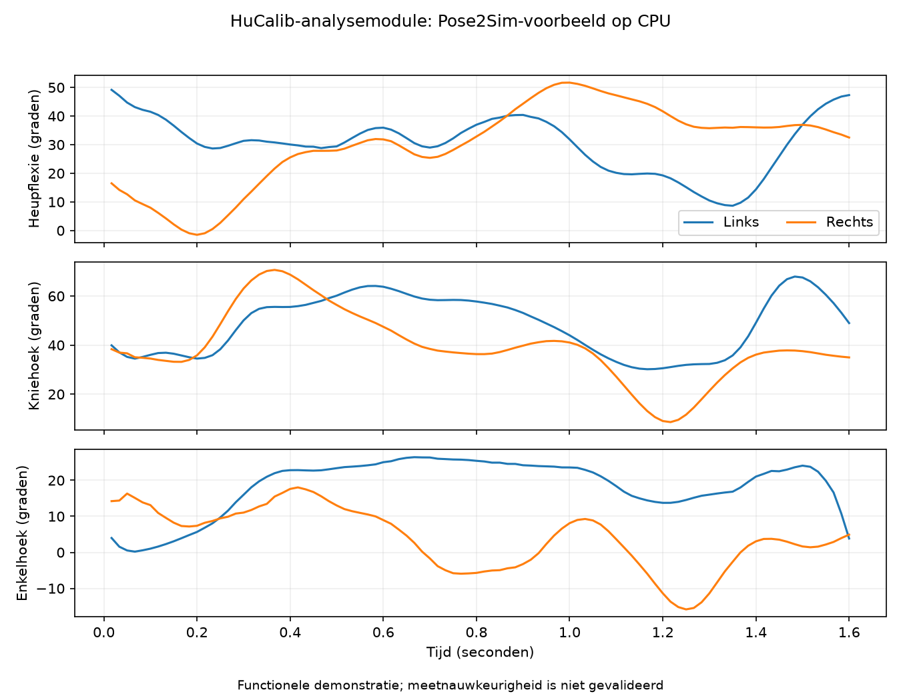

# Pose2Sim als afzonderlijke analysemodule

De module leest een afgeronde HuCalib-opname en maakt een zelfstandig
Pose2Sim-project in een **nieuwe map buiten de opname**. De opname en haar
kalibratiekopie worden niet gewijzigd. De module is bereikbaar via het
Nederlandstalige venster **Bewegingsanalyse**, naast de Python- en
commandoregelinterface. Zie [bediening en interfacevoorbeelden](analysis_interface.md).

## Vooraf controleren

De module controleert het sessieschema, unieke camera-ID's, camera- en
kalibratievolgorde, kalibratienamen en controlesommen. Iedere opnameronde moet
exact één succesvolle regel voor iedere camera hebben. Videoframenummers
moeten aansluiten op de opnamerondes en manifesttellingen. Alle video's worden
volledig teruggelezen om aantallen, beeldformaat en FPS onafhankelijk te
controleren. Ongeldige kalibratieparameters en paden buiten de opnamemap worden
geweigerd.

Ontbrekende of geschaalde frames, onvolledige video's, verschillende video-FPS,
een onafgeronde FPS-correctie en een resolutieverschil met de kalibratie blokkeren
de analyse. Deze eerste versie herstelt geen framegaten. Daarvoor is later een
expliciete aanpak voor tijdkoppeling nodig; de bestanden afkappen of hernummeren
zou een verkeerde camerakoppeling kunnen verbergen.

De inputvideonamen worden in de analysemap genormaliseerd naar `cam01`, `cam02`,
enzovoort. De namen in de gekopieerde TOML worden daarmee gelijkgesteld.
Intrinsics, vervorming, rotatie, translatie en wereldoriëntatie blijven gelijk.
`camera_mapping` bewaart de relatie met de oorspronkelijke bron-ID en tabel.

## Omgeving en aanroep

Gebruik Python 3.11 of hoger voor de module. Installeer Pose2Sim in een aparte
omgeving; de normale HuCalib-requirements blijven ongewijzigd. De optionele
requirements verwijzen naar de geteste upstream-commit. Git moet beschikbaar
zijn voor deze installatie. Voorbeeld voor Windows, vanuit de repository:

```powershell
py -3.12 -m venv .venv-pose2sim
.venv-pose2sim\Scripts\python.exe -m pip install -r requirements-pose2sim.txt
```

Dit installatiepad en de OpenSim-wheels moeten nog op Windows worden getest.
De cloudproef gebruikt Python 3.12 op Linux. Pose2Sim kan bij de eerste analyse
AI-modellen downloaden; die horen in de modelcache, niet in de GitHub-repository.

Start vervolgens vanuit de HuCalib-omgeving en de repositorymap:

```powershell
python -m mocap_app.analysis.pose2sim --session C:/data/opname --output C:/data/analyse-001 --config C:/data/Config.toml --python .venv-pose2sim/Scripts/python.exe
```

`--config` is een volledig Pose2Sim-configuratiesjabloon, bijvoorbeeld het
officiële `Demo_SinglePerson/Config.toml`. Het wordt bewaard en aangevuld met de
analysemap, gecontroleerde FPS, CPU/ONNX Runtime, één pose-worker en uitgeschakelde
interactieve vensters. Persoonsmassa, lengte, model- en filterkeuzes blijven
afkomstig uit het sjabloon. Controleer deze voor een echte deelnemer; de
demoinstellingen zijn geen persoonlijk meetprotocol.

De uitvoermap mag nog niet bestaan, ook niet na een mislukte analyse. Kies bij
een herhaling een nieuwe map, zodat eerdere resultaten en foutlogs behouden
blijven. `--timeout` bepaalt de tijdslimiet per stap, standaard 1800 seconden.

De Python-aanroep is ook beschikbaar als
`mocap_app.analysis.pose2sim.run_analysis(...)`; de GUI importeert Pose2Sim niet.

## Stappen en bestanden

De module voert achtereenvolgens pose-detectie, bewegingsgebaseerde
synchronisatie, persoonskoppeling, triangulatie, filtering, markeruitbreiding
en OpenSim-kinematica uit. Elke stap draait als een apart proces in de
Pose2Sim-omgeving. Een mislukte stap of tijdslimiet stopt de volgende stappen.
De commandoregel geeft dan exitcode 1 terug; `analysis.json` vermeldt de fout.

```text
analyse-001/
├── analysis.json                 # status, stappen, waarschuwingen, koppeling, hashes
├── environment.json              # gebruikte Python en Pose2Sim/ONNX Runtime
├── config-template.toml          # oorspronkelijke instellingen
├── effective-config.json         # effectieve instellingen
├── poseEstimation.log            # ook een log voor iedere volgende stap
├── source-metadata/              # manifest, framelog, originele JSON/TOML-kalibratie
└── project/
    ├── Config.toml               # effectieve Pose2Sim-configuratie
    ├── videos/                   # zelfstandige videokopieën
    ├── calibration/
    ├── pose/                     # gedetecteerde 2D-punten
    ├── pose-sync/
    ├── pose-associated/
    ├── pose-3d/                  # TRC-trajecten in meters
    └── kinematics/               # MOT-hoeken, OSIM-model en OpenSim-logs
```

Een analyse is pas `completed` wanneer traject- en hoekbestanden aanwezig zijn,
numerieke rijen bevatten, eindige waarden hebben en een oplopende tijdkolom
hebben. `result_summary` vermeldt werkelijke rijaantallen, markers/coördinaten,
tijdbereik en afwijkingen tussen header en data. `completed` betekent een
functioneel voltooide uitvoering, geen klinisch betrouwbare meting.

Bij de geteste Pose2Sim-commit bevat de gefilterde demo-TRC 96 rijen terwijl de
header nog 97 vermeldt. Dit wordt als `result_header_frame_count_mismatch`
geregistreerd; de adapter wijzigt de Pose2Sim-uitvoer niet stilzwijgend.

Host-uitleestijden bewijzen geen sensor- of belichtingssynchronisatie.
Pose2Sim-synchronisatie schat een tijdverschuiving uit beweging; deze module
valideert de resterende synchronisatiefout niet. `--assume-synchronized` slaat
die stap expliciet over en bewaart die aanname. Gebruik dit alleen voor reeds
gesynchroniseerde invoer. USB-identiteit en correcte fysieke plaatsing van
camera's moeten nog steeds tegen de kalibratie worden gecontroleerd.

## Proeven met de officiële voorbeeldvideo's

```text
python -m unittest discover -s tests -v
python tests/smoke_pose2sim_analysis.py --demo C:/data/Demo_SinglePerson --calibration C:/data/Calib_qualisys.toml --session C:/data/demo-sessie --output C:/data/demo-analyse --python C:/omgevingen/pose2sim/Scripts/python.exe
```

De integratieproef importeert de vier originele video's zonder hercodering,
behoudt hun 60 FPS en registreert de mediaframenummers. Zij gebruikt geen
hosttijdstempels alsof het echte webcammetingen zijn. Beide uitvoermappen moeten
nieuw zijn. De proef doorloopt de volledige analyse inclusief synchronisatie.

Twee originele demovideo's zijn 1080 pixels breed terwijl hun kalibratie 1088
vermeldt. Daarom schakelt uitsluitend deze integratieproef expliciet
`diagnostic_resolution_mismatch=True` in. De CLI heeft daarvoor
`--diagnostic-resolution-mismatch`. Die optie bewaart waarschuwingen en verandert
de kalibratie niet. Gebruik de uitkomst om werking te testen, niet om
meetnauwkeurigheid te claimen. Framegaten kunnen met deze optie niet worden
genegeerd.

De cloudproef op 9 oktober 2026 doorliep alle zeven stappen op CPU. Iedere camera
leverde 100 pose-JSON-bestanden. De ruwe trajectfile bevat 97 rijen met 22 markers;
de uitgebreide trajectfile bevat 96 rijen met 65 markers. OpenSim leverde 96
tijdstappen met 62 coördinaten. De waarden zijn eindig, het geschaalde model kan
worden geladen en de bron-/kopiehashes komen overeen. Alle 41 unit-tests slagen.

### Waarom deze demo maar circa 1,6 seconde oplevert

Op 11 oktober 2026 zijn de bestanden uit de gebruikte Pose2Sim-commit
`68304b47195dac80bc341cdfd9669140609358c4` opnieuw met `ffprobe -count_frames`
onderzocht. **Alle vier originele `Demo_SinglePerson/videos/cam*.mp4` bevatten
100 decodeerbare frames bij 60 FPS, dus 1,666667 seconde video.** De SHA256-hashes
komen exact overeen met `tools/prepare_windows_demo.py`. De testbuild heeft geen
langere opname ingekort: dat script downloadt de oorspronkelijke bestanden en
`import_demo` kopieert ze zonder hercodering en registreert tot het einde.

| Stap | Aantal / tijd | Bewijs en beperking |
| --- | --- | --- |
| Originele cameravideo's | 100 frames per camera, 60 FPS | Opnieuw volledig geteld met ffprobe; hashes gelijk aan de testkit |
| Pose-detectie | 100 JSON-bestanden per camera | Vastgelegd in de eerdere cloudproef |
| Ruwe 3D-trajecten | 97 meetregels | Vastgelegd in de eerdere cloudproef; oorspronkelijke synchronisatie- en triangulatielogs zijn in deze workspace niet beschikbaar |
| Gefilterde trajecten / OpenSim | 96 meetregels | Upstream filtering sluit de laatste regel uit; eindresultaat heeft daadwerkelijk 96 tijdstappen |
| Geüpload `motion.mot` | 0,01666667 tot 1,60000000 s | 96 meetregels; verschil eerste-laatste tijdstip is 1,58333333 s |
| GaitDynamics-referentie | 159 rijen bij 100 Hz, tot circa 1,59667 s | Resampling binnen hetzelfde tijdsinterval; geen extra bewegingsduur |

Het configuratiesjabloon heeft `project.frame_range = 'auto'`, geen expliciete
limiet van 100 of 96 frames. De HuCalib-analysemodule verandert het projectpad en
de FPS, maar stelt geen kort framebereik in. Pose2Sim kan bij synchronisatie en
triangulatie wel de gezamenlijke/geldige periode beperken. De precieze verdeling
van de drie verdwenen regels tussen 100 invoerframes en 97 trajectregels vereist
de oorspronkelijke `synchronization.log`, `triangulation.log` en tussenbestanden.
Die verdeling wordt hier niet als vastgesteld gepresenteerd.

Voor de stap 97 naar 96 is er concreet bewijs in
[Pose2Sim filtering.py](https://github.com/perfanalytics/pose2sim/blob/68304b47195dac80bc341cdfd9669140609358c4/Pose2Sim/filtering.py#L904):
bij `auto`/`all` gebruikt de code het laatste framenummer als exclusieve bovengrens
en selecteert vervolgens tot dat nummer minus één. Daardoor verdwijnt de laatste
meetregel. Dezelfde indexberekening is afzonderlijk gereproduceerd: 97
opeenvolgende framenummers leveren 96 geselecteerde regels op. Dit is een
grensfout in deze upstreamversie, geen fysieke beperking van filtering en geen
HuCalib-duurlimiet. Er is in dit onderzoek geen runtime-code gewijzigd.

In dezelfde bronversie zijn ook de cameravideo's van `Demo_MultiPerson` en beide
`Demo_Batch`-trials 100 frames bij 60 FPS. De langere bestanden
`Content/Pose2Sim Blender.mp4` (40,733333 s, 1.222 frames bij 30 FPS) en
`Content/Pose2Sim_Blender_short.mp4` (8,9 s, 267 frames bij 30 FPS) staan bij de
Blender-presentatie. Zij vormen geen vervangende set van vier gekalibreerde
cameravideo's. Andere, niet onderzochte videoverzamelingen kunnen wel langere
bruikbare opnamen bevatten; controleer dan de afzonderlijke camerabestanden,
kalibratie en synchronisatie.

**Gevolg:** `frame_range` verruimen maakt deze bronvideo's niet langer. Voor een
echte duurtest is een langere meercamera-opname met passende kalibratie nodig.
De korte bestanden herhalen kan uitsluitend een technische belastingproef
opleveren, geen langere onafhankelijke beweging of betrouwbare dynamische
analyse door de sprongen bij iedere herhaling.

Hieronder staan de berekende heup-, knie- en enkelhoeken uit deze demo.
Blauw is links, oranje is rechts. Dit is een functionele demonstratie;
de meetnauwkeurigheid is niet gevalideerd.



Windows-processen, de GUI, packaging, webcamdrivers, fysieke reconnect-identiteit
en timing bij echte webcamopnames blijven afzonderlijke praktijktests. Deze stap
voegt geen GaitDynamics, krachtenberekening of hardware-synchronisatie toe.
