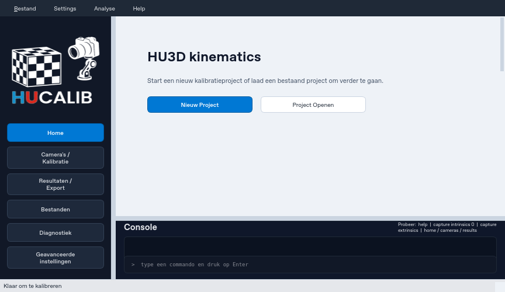
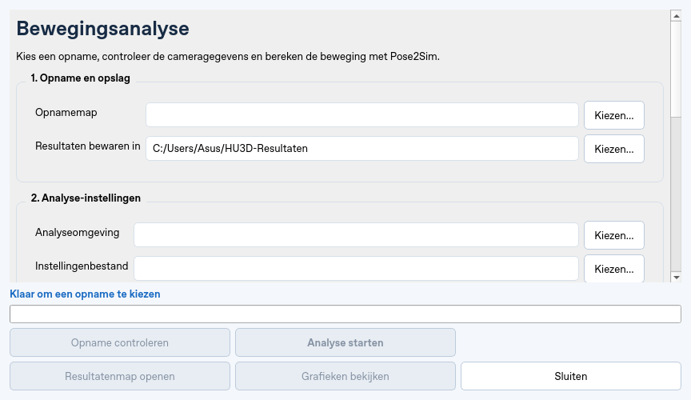

# Windows-testbuild: downloaden, instellen en testen

Deze testversie is een **draagbare ZIP**, geen installer of gepubliceerde
release. Je bestaande HuCalib-installatie wordt niet bijgewerkt. De testbuild
heeft automatische updates uitgeschakeld en bewaart gegevens in zijn eigen
map. De zichtbare appnaam is **HU3D kinematics**; het startbestand heet
`HuCalib.exe`. Pose2Sim wordt apart geïnstalleerd. Voor de eerste tests zijn geen webcams
nodig.

## 1. De testbuild verkrijgen

De Windows-buildworkflow staat op de branch `feat/recording-session-metadata`.
Een push van build- of appwijzigingen op die branch start de workflow, als
GitHub Actions in de fork is ingeschakeld.

1. Open https://github.com/jaapjansen1977/HuCalib/actions.
2. Zoek **Windows-testbuild** en open een uitvoering die bij de juiste commit
   hoort. De uitvoering moet groen zijn.
3. Download onder **Artifacts** het bestand **HuCalib-Windows-testbuild-…**.
   Hiervoor moet je bij GitHub zijn ingelogd. Artifacts blijven 14 dagen staan.
4. Pak de hele ZIP uit in een schrijfbare map, bijvoorbeeld
   `C:\Users\jouwnaam\Documents\HuCalib-Test`. Laat de mappenstructuur intact.
   Open de exe niet rechtstreeks vanuit de ZIP.

Als er nog geen uitvoering is: controleer of Actions in de fork is ingeschakeld.
Een nieuwe workflow op een nog niet samengevoegde branch kan nog niet als
handmatige workflow in de standaardbranch staan; de push-trigger gebruikt wel
de testbranch. Merge alleen om een workflow zichtbaar te maken is niet nodig.
Een ontbrekende of rode uitvoering betekent dat er nog **geen geslaagde
Windows-testbuild** beschikbaar is. Bewaar dan de buildfoutmelding; een groene
cloudtest op Linux vervangt die Windows-build niet.

De inhoud na uitpakken:

```text
HuCalib/                         # HuCalib.exe plus _internal en TESTBUILD.json
Demo/opname/                     # vier video's, manifest, framelog, kalibratiekopie
Demo/Config.toml                 # officiële Pose2Sim-demo-instellingen
setup_analysis.ps1
requirements-pose2sim.txt
Installeer-GaitDynamics.cmd       # optionele begeleide WSL2-installatie in de app
LEESMIJ-WINDOWS.md
frozen-gui-smoke.json             # startproef van de daadwerkelijk gebouwde exe
build-dependencies.txt
SHA256SUMS.txt
```

Voor GaitDynamics kies je **Analyse → GaitDynamics installeren…**. Je hoeft
geen Linux-opdrachten te typen. Klik na een eventuele Windows-herstart opnieuw
op **Installeren / doorgaan**. De werking op een echte Windows-computer met
WSL2 moet nog worden getest; de automatische GUI- en CPU-tests vervangen die
installatieproef niet. Zie [de instructies](gaitdynamics.md).

De app alleen bekijken vraagt geen Python-installatie: open
`HuCalib\HuCalib.exe`. Je ziet **Windows-testbuild** in de venstertitel.
Voor bewegingsanalyse is stap 2 nodig.

### Een volgende testbuild proberen

Pak een nieuwe build uit in een aparte map met een korte naam, bijvoorbeeld
`C:\Users\Asus\HU3D-Test2`. Je kunt je bestaande analyseomgeving blijven
gebruiken: kies in het analysevenster het bestaande
`.venv-pose2sim\Scripts\python.exe` uit de vorige testmap en kies
`Demo\Config.toml` uit de nieuwe testmap. Een nieuwe Pose2Sim-installatie is dan
niet nodig. Bewaar de vorige testmap: daar staat de gebruikte Python-omgeving.
Verplaats een bestaande `.venv-pose2sim` niet.

Controleer bij deze build ook het volgende, zonder webcams of ChArUco-bord:

- Het hoofdvenster, analysevenster en de grafieken vermelden **HU3D kinematics**.
- Het analysevenster opent binnen de beschikbare schermruimte. Verklein het
  venster: de inhoud scrolt, de actieknoppen, status en voortgang blijven staan.
- Ook bij je normale Windows-schermschaal blijven alle actieknoppen bereikbaar.
- Het hoofdvenster heeft scrollbare pagina's en navigatie; de grafiek schaalt
  mee wanneer je het resultatenvenster kleiner maakt.

De vensters gebruiken de schermgrootte in Qt-logische pixels, zodat Windows-
schermschaal en de taakbalk meetellen. De automatische startproef controleert
het hoofdvenster en de analyseknoppen bij 640×480 en 864×500. De unit-tests
controleren ook grotere tekst. Test de daadwerkelijke Windows-schermschaal
op je eigen computer.

Deze afbeeldingen tonen de aangepaste interface bij 864×500 in de Qt-cloudtest:





## 2. Eenmalig de analyseomgeving instellen

Doe dit op **Windows 10/11, 64-bit** met internet. Installeer **Python 3.12,
64-bit** en **Git for Windows** en zorg dat `python` en `git` in een nieuwe
PowerShell beschikbaar zijn. Administratorrechten zijn niet nodig voor de
uitgepakte app zelf.

Open PowerShell in de uitgepakte testmap en voer uit:

```powershell
python --version
git --version
.\setup_analysis.ps1
```

Wanneer PowerShell lokale scripts blokkeert, kun je deze concrete setup één
keer starten zonder het beleid van de computer blijvend te wijzigen:

```powershell
powershell -NoProfile -ExecutionPolicy Bypass -File .\setup_analysis.ps1
```

Het script maakt `.venv-pose2sim`, installeert de vastgelegde Pose2Sim-commit en
controleert imports van Pose2Sim, OpenSim en ONNX Runtime. De eerste installatie
kan enige tijd duren. Als er nog geen analyse-instellingen zijn, vult het
script de Python- en configuratiepaden voor de GUI in. Bestaande voorkeuren
worden bewaard. Installeer Pose2Sim niet in de HuCalib-buildomgeving.

Als een Windows-wheel ontbreekt of een DLL niet geladen kan worden, **stop deze
proef en noteer de fout**. De beschikbaarheid van alle analysedependencies op
Windows is juist een onderdeel dat deze test moet vaststellen. Ga niet zomaar
over op een andere Python-versie of een andere Pose2Sim-commit: dan test je een
andere combinatie.

## 3. De app met de voorbeeldvideo's testen

1. Start `HuCalib\HuCalib.exe`.
2. Open **Analyse → Bewegingsanalyse…**.
3. Kies als opnamemap `Demo\opname`.
4. Kies een resultatenmap buiten `Demo\opname`, bijvoorbeeld
   `C:\Users\jouwnaam\Documents\HuCalib-Testresultaten`.
5. Controleer de twee instellingen. Indien niet automatisch ingevuld:
   **Analyseomgeving** = `.venv-pose2sim\Scripts\python.exe`,
   **Instellingenbestand** = `Demo\Config.toml`.
6. Laat **Diagnostische demoproef** eerst uit en klik **Opname controleren**.
   Verwacht: analyse wordt geblokkeerd omdat video en kalibratie bij twee
   camera's verschillende resoluties hebben. Dit is een bekende demo-afwijking.
7. Schakel **Diagnostische demoproef** in en controleer opnieuw.
   Verwacht: vier camera's, 100 frames per camera, 60 beelden/seconde en zichtbare
   waarschuwingen. **Analyse starten** wordt beschikbaar.
8. Klik **Analyse starten**. De eerste pose-detectie kan modellen downloaden;
   die horen in de lokale modelcache, niet op GitHub. Het venster moet blijven
   reageren. Sluiten is tijdens de uitvoering geblokkeerd.
9. Wacht op **Analyse voltooid**. Alle zeven stappen moeten klaar zijn.
10. Open **Grafieken bekijken**. Probeer knie, heup, enkel, bekkenverplaatsing,
    rug en pols. De demo levert 62 selecteerbare modelcoördinaten op.
11. Open **Resultatenmap openen** en controleer `analysis.json`, de staplogs,
    TRC-bestanden in `project\pose-3d` en MOT/OSIM in `project\kinematics`.
12. Sluit de app en start opnieuw. De gekozen analyseomgeving en het
    instellingenbestand moeten onthouden zijn. Een tweede analyse moet een
    nieuwe uitvoermap maken.

De Linux-referentieproef levert 96 OpenSim-tijdstappen. De gefilterde TRC heeft
bij deze Pose2Sim-commit een header met 97, terwijl er 96 meetregels staan; dat
moet als waarschuwing worden gemeld. Vergelijk op Windows werking, aantallen,
eindige waarden en bestandsstructuur. Kleine numerieke verschillen tussen
platforms zijn mogelijk. De demo valideert geen meetnauwkeurigheid, webcam-
timing of fysieke camera-identiteit.

### Modelconversie voor GaitDynamics testen

De [geslaagde Windows-testbuild van commit fdee35b](https://github.com/jaapjansen1977/HuCalib/actions/runs/38135537887)
bevat deze bediening. Download onder **Artifacts** de ZIP
**HuCalib-Windows-testbuild-fdee35b…** en pak die in een aparte, korte map uit.
Je kunt de Pose2Sim-omgeving uit je vorige testmap blijven gebruiken.

Open na de geslaagde analyse **GaitDynamics voorbereiden**. Controleer de
model- en bewegingsbestanden en gebruik bij **Analyseomgeving** dezelfde
Pose2Sim-Python als hierboven. Klik **Pose2Sim-model converteren…**, kies een
resultatenmap en wacht op **Modelconversie gereed**. Het venster selecteert
vervolgens de nieuwe `motion.mot` en `model.osim`. Bewaar `conversion.json`;
dit bevat de geometrische afwijkingen en de controles op alle tijdstappen.
Voor deze test zijn geen webcams of nieuwe installaties nodig.

De conversie werkt in Windows. De krachtvoorspelling zelf gebruikt nog een
afzonderlijke Linux/WSL2-omgeving en wordt niet door deze knop gestart.
Zie [de GaitDynamics-instructies](gaitdynamics.md) voor de werkwijze en
beperkingen van de modelvereenvoudiging.

## 4. Testresultaten vastleggen

### Filterfout in de eerste testbuild

Krijg je tijdens filtering `Failed to import any of the following Qt binding
modules`? De eerste testbuild schakelt het tonen van filtergrafieken uit, maar
het opslaan ervan gebruikt in Pose2Sim eveneens Qt. Open `Demo\Config.toml`
met Kladblok en wijzig onder `[filtering]` `save_filt_plots = true` in
`save_filt_plots = false`. Bewaar het bestand en start de analyse opnieuw met
een nieuwe resultatenmap. Bewaar de vorige resultaten voor diagnose.
De grafiekenviewer in HuCalib blijft beschikbaar. Nieuwere builds schakelen
beide filtergrafiekopties automatisch uit.

Noteer per punt **geslaagd**, **mislukt** of **niet getest**:

| Controle | Verwachting |
|---|---|
| Starten en sluiten | Geen crash; titel vermeldt Windows-testbuild |
| Analyseomgeving installeren | Pose2Sim, OpenSim en ONNX Runtime importeren |
| Normale democontrole | Resolutieverschil blokkeert de analyse |
| Diagnostische controle | Vier camera's, 100 frames, 60 FPS |
| Analyse | Alle zeven stappen klaar; interface blijft reageren |
| Grafieken | Alle 62 coördinaten selecteerbaar; meters versus hoeken onderscheiden |
| Verkenner | Juiste resultatenmap opent |
| Herstart en herhaling | Voorkeuren onthouden; eerdere resultaten blijven bestaan |

Bewaar `HuCalib\TESTBUILD.json`, `frozen-gui-smoke.json`,
`build-dependencies.txt`, `analysis-dependencies.txt` en het analyserapport.
Bij een fout: bewaar ook de staplog en een screenshot van de melding. Noteer
Windows-versie en Python-versie. Er hoeven geen AI-modellen naar GitHub.

Webcamopname, reconnect-identiteit, kalibratie en timing volgen in een aparte
praktijktest. **GaitDynamics voorbereiden** controleert de invoer; de
afzonderlijke rekenmodule vereist Linux/WSL2. Zie [de GaitDynamics-koppeling](gaitdynamics.md).

## Voor de ontwikkelaar: lokaal bouwen

Op Windows met Git en Python 3.12, vanuit de repository op de testbranch:

```powershell
.\build_testbuild.ps1
```

Het script maakt een aparte buildomgeving, voert de unit-tests uit, bouwt
de exe met PyInstaller en start die exe in een automatische GUI-proef zonder
webcams. Alleen bij succes wordt de testkit met gecontroleerde demobestanden
klaargezet in `dist-testbuild\HuCalib-testbuild`. Er komt ook een ZIP met de
korte Git-revisie in de naam. Een bestaande testkit wordt niet overschreven;
bewaar of verplaats die eerst. Een onvolledige uitvoermap na een fout wordt
evenmin automatisch verwijderd.

Er worden geen Velopack-release, GitHub-release, tag of automatische updates
gemaakt. De bestaande `build_release.ps1` blijft beschikbaar voor de normale
releaseprocedure; die is niet nodig voor deze test.
De bestaande releaseconfiguratie verwijst nog naar de oorspronkelijke
HuCalib-repository. Voor een reguliere release van deze fork moet die
afzonderlijk worden aangepast; de testbuild gebruikt die updatefeed niet.
